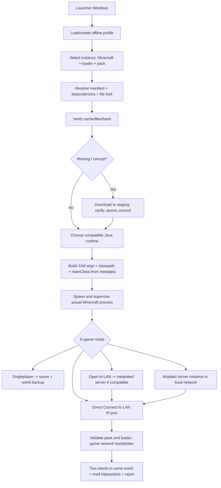

# OFFLINE MINECRAFT LAUNCHER — HỒ SƠ NGHIÊN CỨU TỔNG THỂ v5

**Ngày:** 13/11/2026  
**Loại tài liệu:** Reverse engineering + đối chiếu định dạng/protocol + functional specification; **KHÔNG phải bản triển khai hay kết quả E2E**.  
**Trọng tâm:** Minecraft Java **Singleplayer**, local/offline profile, **modpack**, Fabric/Forge/NeoForge, host/join qua **LAN**; phần Microsoft/Xbox/Premium login loại khỏi phạm vi sản phẩm.  
**Tiêu chuẩn:** *Bấm Play là phải có Minecraft thật; mở world lưu được; 2 máy LAN cùng modpack phải chơi được*. Mọi kết luận phân biệt `Đã xác minh bytecode` (BC), `Tài liệu ngoài` (EXT), `Thiết kế mới` (DES) và `Cần thử nghiệm` (TEST).

> **Giới hạn quyền sử dụng:** Local profile không xác thực tài khoản trực tuyến. Điều này **không tự cấp bản quyền Minecraft**, cũng không cho phép chia sẻ game JAR/proprietary assets trái giấy phép. Tài liệu nghiên cứu cơ chế hoạt động và thiết kế launcher sử dụng các file game người dùng có quyền truy cập; không tuyên bố có một con đường phân phối Minecraft miễn phí được Mojang cấp phép. Xem EULA ở phần nguồn.

## A. NGUỒN VÀ PHẠM VI CHỨNG CỨ

| ID | Nguồn | Tình trạng | Tin được về điều gì |
|---|---|---|---|
| SRC-01 | `original-TLauncher-2.923.zip` do người dùng tải lên | 1.415 entries / 1.193 Java `.class`; SHA256 `0e83efed2a35e23fda8ecc87220516b5369e6628f9fd35da4e9082562b52f250` | Cấu trúc, phương thức, lời gọi *của bản 2.923*, không mặc nhiên của bản 2026 |
| SRC-02 | `TLauncher.exe` 72.155.352 bytes | SHA256 `c053b982e7ed3ab28eddcc1c74f418bdea7425e1462535a319fde6b2f73197b2` | PE native, dấu GraalVM/JavaFX và Starter/Updater; không đồng nhất source 2.923 |
| SRC-03 | `TLauncher-Installer-2.1.0.5.exe` 103.089.568 bytes | SHA256 `25189514c0b7739bf5549331fec12db48ab694770cd20d5f2b23057e73fd1e17` | Bộ cài 2026, Bootstrapper đã trích bytecode; không chứng minh modded client ở trong installer |
| SRC-04 | `tlauncher-2.0.properties`, log và cây thư mục Windows người dùng gửi | Chỉ danh sách khóa và giá trị đã cung cấp | Các setting đã bật/tắt; chưa có log một phiên game thành công |
| SRC-05 | Mojang/Minecraft, Fabric, Modrinth, NeoForge, CurseForge docs; Minecraft Wiki | Tra cứu 13/11/2026 | Đặc tả metadata, modpack, Java runtime, dedicated server và LAN |
| SRC-06 | Hồ sơ v4 từ phân tích trước | Dùng làm baseline, đã kiểm tra lại một số phần bằng `javap -p -c` | 34 vị trí bytecode và 18–24 test dự kiến; chưa chứng thực E2E |

**Giới hạn dữ liệu:** Archive 2.923 chứa nhiều class có tham chiếu tới `org.tlauncher.modpack.domain.client.*` nhưng chính các `.class` domain này không nằm đủ trong ZIP. Thiếu mọi test thật trên hai PC, server modded, traffic capture, chụp UI thực tế. Vì vậy không thể nói “đã biết 100% toàn bộ logic TLauncher 2026”.

## B. PHẠM VI SẢN PHẨM ĐÃ KHÓA

### B1 — Phải có (P0)

1. Profile cục bộ: tạo/chọn/sửa tên, lưu định danh ổn định, không buộc nhập email/mật khẩu.
2. **Singleplayer thật**: tạo world, load world, lưu, thoát, vào lại; modded world hoạt động.
3. Cài Minecraft theo metadata phiên bản thật, quản lý thư viện + assets + natives + loader.
4. Cài Fabric và ít nhất một modpack được kiểm chứng; Forge/NeoForge là các adapter bổ sung cần kiểm thử riêng, không gọi là tương thích nếu chưa chạy.
5. Import/export `.mrpack`, import thư mục pack tự tạo; lockfile và hash chính xác; CurseForge ZIP adapter có thể bổ sung.
6. Phân giải required/optional/incompatible; chia client/server/both, phát hiện xung đột.
7. Chơi LAN 2+ máy: ít nhất dedicated modded server tự quản trong LAN tin cậy; Direct Connect được, rejoin không mất inventory/world.
8. Download có timeout, retry, `.part`, checksum, resume nếu server cho phép, staging/rollback và dọn dẹp an toàn.
9. Java runtime đúng phiên bản và kiến trúc, quản lý RAM, argv và PID, log/crash diagnostics.
10. Backup world, chống ghi đè nhầm world/config/modpack; có khả năng khôi phục.

### B2 — Nên có (P1)

- Open to LAN từ Singleplayer nếu integrated server/mod hỗ trợ profile offline; không hứa mọi version làm được.
- Phát hiện game LAN qua multicast, bên cạnh Direct Connect thủ công.
- Export server pack từ client pack; tự động xử lý client-only mods.
- Đồng bộ lockfile / modpack giữa PC A và B theo file manifest, không tự ý thay đổi dữ liệu người nhận.
- UI chức năng: danh sách instance, mod manager, tiến độ, console, logs, backup, server list, kiểm tra mạng.
- Hỗ trợ import CurseForge manifest, URL mod của nguồn uy tín, optional resourcepacks/shaderpacks.

### B3 — Chưa ưu tiên (P2)

- UI pixel-perfect giống TLauncher, hệ thống skin độc quyền, TL Mods cloud, quảng cáo, vendor auto-update.
- Tự động P2P chuyển toàn bộ modpack qua LAN (bắt đầu bằng export/import + content hashes).
- Tạo tài khoản online, OAuth và mọi hạng mục Microsoft/Xbox/Premium (cố ý loại bỏ, không nghiên cứu triển khai).
- Public WAN hosting, bypass xác thực của server công cộng, giả mạo người chơi khác.

## C. TOÀN BỘ PIPELINE CHƠI GAME THỰC TẾ



**[BC] Bản 2.923** `MinecraftLauncher.start(boolean)` thực sự lần lượt gọi ở bytecode PC 10/14/18/22/26/30: `collectInfo` → `downloadResources` → `checkExtraConditions` → `constructProcess` → `launchMinecraft` → `postLaunch`. `launchMinecraft` sử dụng `JavaProcessLauncher.start`, cuối cùng gọi `ProcessBuilder.start` (PC 14 của JavaProcessLauncher). **[DES]** Luồng trên không có nghĩa các module mới đã tồn tại.

### C1. State machine khuyến nghị

`IDLE → PROFILE_READY → INSTANCE_RESOLVED → RESOLVING_FILES → DOWNLOADING? → VERIFYING → JAVA_READY → PREPARING_LAUNCH → STARTING → RUNNING → EXITED | CRASHED`.

Không được chuyển `READY` nếu: manifest/loader chưa resolve; Java sai major; file hash lỗi; file core thiếu; giải nén natives thất bại. Không được báo `PLAY_SUCCESS` chỉ từ `spawn` thành công, mà phải quan sát giai đoạn game sẵn sàng (log, cửa sổ, màn hình xác nhận hoặc tích hợp game event). Process supervisor phải luôn ghi PID, executable path, args đã redact, exit code, elapsed time, crash report path.

## D. OFFLINE PROFILE / PLAYER IDENTITY

### D1. Bằng chứng nguồn 2.923

- `[BC] org.tlauncher.tlauncher.minecraft.auth.FreeAuthentication.pass()` kiểm tra `Account.getUUID` (PC 4); nếu null gọi `UUID.randomUUID` (PC 17), chuyển thành chuỗi, lưu UUID + UserID + DisplayName; nếu đã tồn tại thì giữ UUID và làm mới display name.
- `[BC] ProfileManager.updateFreeAccountField(String)` (PC 90–103) có nhánh gọi `Account.createFreeAccountByUsername`, lưu `FreeAccountUUID`; lưu/xóa account theo tên trống, và cập nhật cấu hình; lớp `ProfileManager` còn có `getSelectedAccount`, `selectAccount`, `saveProfiles`.
- **Đây không phải bằng chứng rằng server offline dùng chính UUID client vừa tạo.** Cơ chế UUID server khi `online-mode=false` có thể dựa vào nickname hoặc mod/plugin server.

### D2. Contract sản phẩm mới

`LocalProfile{profileId,displayName,localUuid,createdAt,lastUsedAt}`; profile được lưu cục bộ, không có password/token. Tên hợp lệ và không trùng trên một host; đổi tên phải được cảnh báo rõ trước khi dùng cùng world LAN. Preserve mapping tên → playerdata/world và backup trước khi đổi.

`PlayerIdentity` phải tách `localProfileId`, `launchUuid`, `serverAssignedUuid`, `displayName`; **đừng nhầm ID client với khóa inventory**. Test tạo world → nhập modded world → rejoin → quit → rejoin; lặp với PC B. Test đổi nickname để xác nhận cảnh báo và xử lý save đúng.

### D3. Quyền sử dụng

Profile không có authenticated session có thể dùng trong các chế độ không buộc xác thực ngoài; không có cơ chế vượt qua server đòi tài khoản online hợp lệ. Tải/chia sẻ bản game phải tôn trọng EULA và quyền sử dụng nội dung bên thứ ba.

## E. VERSION MANIFEST, GAME FILES, JAVA

### E1. Version catalogue [EXT + BC]

- Minecraft Java dùng version manifest từ `piston-meta.mojang.com` (`version_manifest_v2.json`), có `id/type/url/sha1`, phiên bản release/snapshot. Version JSON xác định downloads, assetIndex, `libraries`, `javaVersion`, `mainClass`, game/JVM `arguments` với rules; một số version cũ dùng `minecraftArguments` và có metadata `inheritsFrom` cho derived/loader versions.
- `[BC] VersionManager.getVersions0()` tổng hợp local & remote; `downloadVersion(...)` lấy downloadables bắt buộc qua `VersionSyncInfo.getRequiredDownloadables`. `AssetsManager` rà tài nguyên.
- `[DES]` Cần parser đa thế hệ: `libraries[].rules`, `natives` classifiers, OS/arch, `extract.exclude`, feature flags, Mojang version inheritance, asset object path theo SHA1, logging config, local version cache.

### E2. File graph tối thiểu

`versions/<id>/<id>.json`, `versions/<id>/<id>.jar`; `libraries/<group>/<artifact>/<version>/...`; `assets/indexes/<assetId>.json`; `assets/objects/<sha1[0:2]>/<sha1>`; `runtime/<java-component>/...` và `natives` tạm theo instance/launch. Không giả định mọi game 2026 dùng schema cũ: parser phải theo version JSON thực tế.

### E3. Chọn Java [BC + EXT]

- `[BC] JavaMinecraftComponent.collectInfo`, `collectResources` và `prepareDefaultJava` xem `JavaVersionName.getMajorVersion`; có cấu hình tải/cài JVM riêng. TLauncher không chỉ dùng `java.exe` bất kỳ trong PATH.
- Theo tài liệu về Minecraft Java: 1.12–1.16.5 thường Java 8; 1.17–1.17.1 Java 16; 1.18–1.20.4 Java 17; 1.20.5–1.21.11 Java 21; **26.1+ Java 25**. Khác biệt loader/mods có thể buộc yêu cầu cụ thể hơn; **metadata thực tế có quyền ưu tiên**.
- `[DES]` Chọn Java bằng `runtime requirements` + OS/arch + game/loader compatibility, probe executable và version; chỉ cho override nếu được cảnh báo. Runtime download phải verify checksum; sandbox path và quyền thực thi phù hợp. Không cộng `-Xmx` lớn hơn RAM có sẵn, đặc biệt khi máy vừa chơi vừa chạy dedicated server.

### E4. Build câu lệnh [BC + EXT]

`MinecraftLauncher.getMinecraftArguments()` lọc `Argument.appliesToCurrentEnvironment` (PC ~225/234); `getJVMArguments()` và `constructClassPath()` tạo argv; `unpackNatives(...)` giải nén native libs. Launcher mới phải đọc `mainClass` thực tế (không hardcode Vanilla cho Fabric/Forge), tính classpath theo rules, thay placeholder cho gameDir/assets/username/uuid, và bỏ hẳn OAuth integration logic. Bắt buộc dùng argument array thay vì nối nguyên một shell command string để tránh lỗi escape Windows path có khoảng trắng.

## F. DOWNLOAD ENGINE, STORAGE, INTEGRITY

### F1. Bằng chứng bản 2.923

- `[BC] DownloaderThread.downloadURL` PC 49 gọi `FileUtil.makeTemp`, tạo `HttpGet`, set connect/socket timeouts và chỉ chấp nhận status 200 trong nhánh này; có luồng stream vào file, kiểm kết quả, rồi `Files.move` tại PC 431. `Downloader` có hàng đợi, listener, retry/abort.
- `[BC] ModpackManager.checkResources/notExistOrCorrect` so file hiện có với metadata SHA-1, đánh dấu những file cần download.
- `[BC] Downloader` và `DownloadableContainer` tồn tại; chưa chứng minh bộ tải hiện tại là transactional đầy đủ hoặc resumable Range cho mọi nguồn.

### F2. Yêu cầu mới (DES)

`PLAN → ACQUIRE(metadata/source) → FETCH(.part) → VERIFY(size/hash) → COMMIT(atomic when same filesystem) → INDEX(cache)`.

Bắt buộc: parallel bounded downloads, per-host concurrency, TLS, timeout, backoff + jitter cho 429/5xx, failover URLs chỉ khi hash trùng; không ghi đè file đang được game sử dụng; retry idempotent; resume qua HTTP Range chỉ khi remote xác nhận Range/ETag hợp lệ; chống zip-slip, zip-bomb, path symlink traversal, absolute/unicode path collisions; kiểm không gian đĩa trước install; cancellation sạch; không xóa dữ liệu người dùng khi không được đồng ý. Hash SHA1 theo metadata Mojang, SHA1/SHA512 theo `.mrpack`, có thể thêm SHA256 nội bộ.

`sourceTrusted` và `license` phải đi trong provenance; download từ repo bên thứ ba chỉ sau khi kiểm URL và checksum. Ngăn SSRF/đường dẫn local khi import manifest không tin cậy; không tự chạy script `.bat/.ps1` lấy từ modpack.

## G. MOD LOADER ADAPTERS

| Loader | Nguồn tài liệu | Mechanism | Rủi ro cần test |
|---|---|---|---|
| **Vanilla** | Mojang version JSON | `mainClass`, libraries, assets, natives, game args | Old/new metadata, rules, Java 25 |
| **Fabric** | Fabric Meta `/v2/versions/loader/...` cung cấp `launcherMeta` | Fabric loader + intermediary + common/client libs + entry point | Fabric API thường là mod riêng; mismatch loader/MC |
| **Forge** | Forge installer/distribution chính thức | Installer/processor chain, thư viện, launch profile | Dòng cũ và mới khác cách cài; không giả định `mainClass` chung |
| **NeoForge** | NeoForged docs | Installer .jar, tạo profile client/server, run scripts server | Dependencies/metadata hiện đại; đặc biệt version compatibility |
| **Quilt** | Xuất hiện trong `.mrpack` dependencies | Adapter tùy chọn sau P1 | Cần implement & test riêng |

**[BC]** Bản 2.923 chứa xử lý “modpack version / baseModLoader” và `resaveVersionWithNewForge`, nhưng **không đủ để tuyên bố tương thích Forge/NeoForge/Fabric 2026**. Không được đơn giản đổi `mainClass` hoặc chép mọi mod `.jar` vào `mods/` rồi coi là cài loader thành công.

## H. MODPACK MANAGER ĐÚNG CHỨC NĂNG

### H1. Bằng chứng source

- `[BC] ModpackUtil.getPathByVersion` đưa tài nguyên vào `versions/<versionId>/...`; `getPath` ánh xạ `MOD=mods`, `RESOURCEPACK=resourcepacks`, `MAP=saves`, `SHADERPACK=shaderpacks`.
- `[BC] ModpackManager.getContainer()` gọi `checkResources`, `checkCompositeResources`, chọn `MapDownloader`, `UnzipEntityDownloader` cho các `additionalFile` chưa đúng hash.
- `[BC] addDependencies()` duyệt dependency, **bỏ qua OPTIONAL và INCOMPATIBLE khi tự cài** (PC 63/74); resolve dependency bắt buộc, gọi đệ quy tại PC 339. Không được suy ra nhánh INCOMPATIBLE tự chặn toàn bộ cài đặt; thiết kế mới phải làm rõ khác biệt.
- `[BC] parseCurse()` đọc `minecraftinstance.json` (không có bằng chứng support `.mrpack`); `analizeArchiver()` phân biệt RAR/ZIP; `installModPack` có `FileUtil.unzipUniversal`.
- `[BC]` Có `backupModPack`, `removeEntity`, `renameModpack`, `changeModpackElementState` (đã thấy phương thức; hành vi chi tiết từng nút chưa truy vết hết).

### H2. Định dạng nhập xuất [EXT + DES]

**Modrinth `.mrpack`:** ZIP chứa `modrinth.index.json` với `formatVersion`, `game`, `versionId`, `files[]` (`path`, hashes SHA1/SHA512, downloads HTTPS, size, env client/server), `dependencies` (Minecraft, Forge, NeoForge, Fabric/Quilt). Import theo thứ tự `overrides/` rồi `client-overrides/` hoặc `server-overrides/` phù hợp. Các path không được thoát instance; URLs cần whitelist/validation. Nếu optional, hỏi người chơi chứ không âm thầm cài.

**CurseForge ZIP:** `manifest.json` ở root và `overrides/`, file mod được khai báo bằng projectID/fileID thay vì tải tràn lan. Có thể gặp trường hợp file bị giới hạn redistribution/API; phải báo rõ và yêu cầu người dùng lấy nguồn được phép, không giả làm thành công.

**Local folder pack:** dùng cho nhóm bạn tự tạo `mods/`, `config/`, `defaultconfigs/`, `resourcepacks/`, `shaderpacks/`, `datapacks/`/saves theo phạm vi; chụp hashes, phát hiện mod ID trùng, tách file chỉ dành client/server; đặt version lock mới. Không lấy ảnh hoặc code proprietary của launcher cũ.

### H3. Solver [DES]

Mỗi mod có: `modId`, `version`, `mcRange`, `loaderRange`, `side`, `depends`, `recommends/optional`, `breaks/incompatible`, `provides`, `nestedJars`, `hash`, `origin`, `license`. Resolve graph với cycle detection/ordering, candidate preference theo pinned version, không tự resolve optional nếu user không chọn; thiếu required hoặc incompatible phải báo blockers. Fabric metadata `fabric.mod.json` phân biệt `depends`, `recommends`, `suggests`, `conflicts`, `breaks`; NeoForge `neoforge.mods.toml`/`mods.toml` có `required/optional/incompatible/discouraged`, side và version ranges. **Không gộp tất cả thành hai boolean required/optional**.

### H4. Instances / rollback [DES]

Mỗi modpack có `instanceId` riêng (`instances/<id>/`), dữ liệu world/config riêng, runtime chung chỉ đọc; lưu manifest+lock; mod install/update chạy trong staging, verify toàn bộ, chụp snapshot trước khi đổi; rollback khi thiếu file hoặc crash boot loop. Không xóa user-added mods/options/saves mà không có sự đồng ý. Nếu Modrinth format thiếu file redistributable, lập danh sách cần tải thủ công thay vì pack sai.

## I. SINGLEPLAYER / WORLD LIFECYCLE

### I1. Ai thực sự tạo và lưu world?

**Minecraft client/integrated server**, không phải launcher. Launcher phải đảm bảo game directory và modpack instance nhất quán. Có thể tạo world mới / Load World bằng giao diện game; nếu muốn launcher “quản lý world”, nó đọc metadata save (NBT `level.dat`) và làm backup/restore khi game đã đóng.

### I2. Bằng chứng BackupWorldAssistant bản 2.923

`constructJavaArguments` gọi `isBackupAvailable`, `collectNewWorlds`, `checkIfWorldsAreChanged`, `checkIfModpackWorldsAreChanged`, `backupWorld`, `saveWorlds`, `deleteOldBackupOrNotExistedWorlds`. `saveWorlds` ghi `worlds.json`; `collectNewWorlds` duyệt `saves` và `versions`, tạo nhánh `backup/saves` và `modpacks_saves`. Có kiểm tra free space, lỗi IOException được log. **Chưa chứng minh backup hoàn toàn nhất quán khi world đang bị ghi**.

### I3. Thiết kế mới

- Save world khi game dừng sạch; không chép directory đang write live trừ snapshot/lock đáng tin.
- Restore có preview `world name`, dataversion, origin pack, modloader, world ID, dung lượng; làm snapshot trước restore.
- Đổi version/loader hay tháo mod có world data: cảnh báo và tự tạo backup trước.
- Test world chứa block/item mod, chest/inventory, chunks đã sinh, entities và dimension; thoát/khởi động lại/rejoin; crash giữa backup không phá file gốc.

## J. LAN HOST, JOIN VÀ DEDICATED SERVER

### J1. Hai con đường khác nhau

| | `Open to LAN` trong Singleplayer | Dedicated modded server trong LAN |
|---|---|---|
| World owner | Minecraft integrated server của máy host | Java server process riêng |
| Thời gian hoạt động | Thường gắn với phiên game host | Có thể chạy khi host không chơi |
| Port | Thường ngẫu nhiên, game thông báo | Ví dụ 25565/TCP (có thể đổi) |
| Discovery | Java LAN announcements qua UDP multicast | Có thể add thủ công; discovery bổ sung |
| Offline sessions | **Không mặc định tương thích mọi version**; cần thử nghiệm/host-side support | Có cấu hình `online-mode=false`, giới hạn truy cập trong LAN tin cậy |
| Resource | Host gánh cả client + server | Server chạy tách biệt, tiêu thụ thêm RAM |
| Mod parity | Cùng loader + mods cần thiết | Client vs server side phân biệt rõ |

**[EXT]** Java Edition LAN broadcast dùng UDP multicast `224.0.2.60:4445`, chứa MOTD và port. Nếu discovery không hiện, vẫn thử Direct Connect `IP:PORT` để phân biệt lỗi multicast và lỗi TCP/firewall. Một số VPN, Wi-Fi client isolation, VLAN hoặc Windows Firewall có thể chặn multicast/TCP. **Launcher không thể cam kết tự mở LAN nếu game integrated server không cho offline profile kết nối**.

### J2. Dedicated server phù hợp mục tiêu nhóm offline

1. Chọn đúng server version/loader và server-side mods; nếu file `.mrpack` có `server-overrides`, áp dụng đúng layered precedence.
2. Server yêu cầu chấp thuận EULA; chỉ người vận hành được đồng ý, không tự bật thầm.
3. Với LAN tin cậy, `server.properties`: `online-mode=false` cho phép không xác thực phiên Mojang, `server-ip=` mặc định trống hoặc bind theo nhu cầu, `server-port=25565`, giới hạn `max-players`, `white-list=true` khi đã cấu hình whitelist, không bật RCON không bảo vệ, chỉ rule Windows Firewall trên Private network/subnet phù hợp.
4. Không NAT/port-forward sang Internet. `online-mode=false` cho phép giả nickname nên whitelist một mình không thay thế xác thực; có thể bổ sung shared-secret/mod xác thực nội bộ và khóa truy cập theo network.
5. Host ghi `PID`, `PORT_LISTENING`, `LOG_READY`, `PLAYER_JOINED`, `WORLD_SAVED`, `EXIT_CODE`; shutdown bằng console `stop` để flush world trước khi backup.
6. Máy khách phải pass pack validator trước connect; game handshake cuối cùng mới là xác nhận tương thích.

### J3. Định danh và inventory

Server offline có thể tạo UUID offline theo username chứ không dùng `localUuid` mà launcher tạo. Do đó cần khóa username trước join, ưu tiên giữ nguyên tên từng máy; theo dõi playerdata/uuid trên host, backup trước đổi tên/online-mode/loader. Nếu hai máy cùng username, có thể đạp nhau hoặc không join được. Không sync world `playerdata` giữa client A và B theo kiểu copy tràn lan.

### J4. LAN network diagnostics [DES]

`NetworkProfile` check: IP + subnet, active adapter, Windows Private/Public, firewall TCP reachability, multicast availability, host port, DNS không cần; `LAN scan` không quét IP internet. Nếu `localhost` connect nhưng remote không được thì nghi firewall/subnet; nếu Direct Connect được nhưng không xuất hiện trong list thì multicast bị chặn. Xác nhận server banner `version/protocol/players` trước gửi login.

## K. MODPACK SYNC PC A ↔ PC B

**Mục tiêu thực tế:** Hai người dùng **cùng bộ mod tương thích**, nhưng không cần đồng nhất shader/client-only mods. Máy A tạo pack lock, chia sẻ qua file `.mrpack` hoặc manifest; máy B import, resolve, download/verify, rồi so `requiredSharedFingerprint` trước khi join.

- `requiredSharedFingerprint`: hash canonical `{MinecraftVersion, loaderType/version, required shared mod ID/version/hash, common config hash, relevant datapack}` với thứ tự chuẩn hóa. Không hash saves/logs/screenshots/options.txt hoặc thế giới của từng người.
- `clientExtras`: optional/client-only mods, shaders, resourcepacks, screenshots, GUI settings không mặc nhiên khóa join.
- `serverOverrides`: server-only mods/config; phải sử dụng manifest server pack; không tự chép client render/graphics mods lên dedicated server.
- “Sync automatic”: phiên đầu chỉ export/import và tự download từ nguồn hợp lệ. Đồng bộ từ peer qua LAN phải có nhận dạng nguồn, hash, quyền nhận file, chống traversal và fail-safe rollback; đưa vào milestone sau.

Trường hợp `mods compatible but registry mismatch`: không đánh giá bằng số file/bytes; bắt game handshake và kiểm registries/config synchronization. Không thể bảo đảm mọi client-only extra đều an toàn; metadata và kiểm thử vẫn là nguồn cuối.

## L. CRASH, DIAGNOSTICS, CONFIG, BẢO MẬT

### L1. Nguồn TLauncher 2.923

- `[BC] MinecraftLauncher.onJavaProcessEnded()` đọc exit code, gọi `CrashDescriptor.scan()`; có console listeners và onJavaProcessError.
- `[BC] ProfileManager` lưu local profile, version Manager giữ local/remote versions; `InnerMinecraftServersImpl` ghi/đọc `servers.dat`. **Đây là danh sách server**, không đồng nghĩa nó mở cổng hoặc chạy dedicated server.
- `[BC] BackupWorldAssistant` backup worlds qua metadata và các thư mục saves; chưa khẳng định thay thế được snapshot atomic.

### L2. Log chuẩn [DES]

- `launcher.log` các stage + bytes/time + URL domain đã redact, result code.
- `game/latest.log`, `debug.log` (nếu có), `crash-reports/*.txt`, `server/logs/latest.log` và `stdout/stderr` redacted.
- Phân loại: `JAVA_VERSION_MISMATCH`, `UNSUPPORTED_LOADER`, `HASH_MISMATCH`, `MISSING_DEPENDENCY`, `MOD_INCOMPATIBLE`, `ZIP_TRAVERSAL`, `NETWORK_TIMEOUT`, `LAN_PORT_BLOCKED`, `SERVER_OFFLINE_AUTH_MODE`, `GAME_CRASH`, `DISK_FULL`, `WORLD_IN_USE`, `PLAYER_IDENTITY_DRIFT`.
- Không thu telemetry/ads/tracking mặc định. Không log API keys, password, access tokens từ bất kỳ mod ngoài nào.

### L3. Những thứ không nên bê từ TLauncher

Không sao chép skin/authlib vendor override, quảng cáo, hot-server promotion và phần tự thay đổi danh sách server từ xa; các chức năng này không cần để offline LAN. Không tin tưởng metadata/links cũ hoặc DLL/exe đóng mã nguồn chỉ vì có chữ ký số. Không phân phối lại proprietary executable, logo và client artifacts mà không có quyền.

## M. FILE LAYOUT VÀ DATA CONTRACT ĐỀ XUẤT [DES]

```text
LauncherData/
  profiles/profiles.json
  manifests/minecraft/...
  cache/blobs/<algorithm>/<hash>
  runtimes/<java-major>/<platform-arch>/...
  instances/<instance-id>/
    instance.json
    modpack.lock.json
    .minecraft/versions/
    .minecraft/mods/
    .minecraft/config/
    .minecraft/defaultconfigs/
    .minecraft/resourcepacks/
    .minecraft/shaderpacks/
    .minecraft/saves/
    .minecraft/logs/
    .minecraft/crash-reports/
  servers/<server-id>/
    server.json
    server.properties
    mods/
    config/
    world/
    logs/
  backups/<instance-id>/<timestamp>/
  logs/launcher.log
```

`instance.json` lưu `instanceId, name, minecraftVersion, loader:{type,version}, javaRequirement, gameDirectory, profileId, packSource, createdAt, lastLaunched, updatePolicy`.

`modpack.lock.json` lưu `schema, packId, packVersion, minecraftVersion, loader, resolvedMods[{modId,version,side,dependencies,sha256,downloadSources,license}], files[{path,hash,size,side}], sharedConfigHash, requiredSharedFingerprint, generatedAt`.

`server.json` lưu `serverId, linkedInstanceId, loader, port, bindAddress, worldPath, javaPath, xmxMb, whitelistEnabled, mode:"trusted-lan-only", lastStart, lastStop`.

**Contract validation:** normalise Windows paths, reject `..`, drive-colon in imported relative paths, symlink to outside instance; portable relative paths in shared lock, absolute machine paths only in private instance settings. Verify ZIP entries and hash before extracting into live workspace.

## N. CÁC LUỒNG LỖI MẤT DỮ LIỆU VÀ CÁCH NGĂN

1. **Đổi nickname**: backup world/playerdata trước, cảnh báo UUID server sẽ khác; cấm tự đổi profile đang host.
2. **Mod bị xóa**: backup world và pack lock trước; không tự xóa config liên quan nếu không yêu cầu.
3. **Update Minecraft major**: tạo instance mới mặc định, giữ bản cũ; nguy cơ world không downgrade được.
4. **Crash/force kill**: rollback install staging; thế giới phải do game/server save chứ launcher không copy live.
5. **Mất mạng**: `.part` còn nhưng chưa verify không được đánh dấu installed; dùng cache hợp lệ.
6. **Disk full**: chặn trước import/download/backup; không xóa backup duy nhất để tạo chỗ.
7. **Multiple clients same instance**: dùng lock hoặc instance copy-on-write; không chạy 2 JVM cùng sửa world trong cùng thư mục.
8. **Dedicated server public**: cấm auto port-forward; không cung cấp `online-mode=false` ra WAN.
9. **Modpack không rõ nguồn**: không auto chạy scripts/embedded executables; hash và cảnh báo binary mod không tin cậy.
10. **LAN player shares same nickname**: detect prejoin, từ chối với thông báo cụ thể.
11. **Server crash khi lưu**: backup before migration + graceful stop + incremental verified saves.
12. **Sai side**: không đưa client-only GUI mod lên server, không bỏ required universal game logic mod.

## O. PHẦN ĐÃ CHỨNG MINH / KHÔNG CHỨNG MINH

| Chủ đề | Nguồn gốc thực tế | Trạng thái |
|---|---|---|
| TLauncher 2.923 launcher pipeline & spawn | `MinecraftLauncher.start`, `JavaProcessLauncher.start` | **BC verified** |
| Non-premium account tạo UUID | `FreeAuthentication.pass`, `ProfileManager` | **BC verified** |
| Tải required files và assets | `VersionManager`, `AssetsManager`, `DownloaderThread` | **BC verified (cấu trúc)** |
| Quản lý mod, maps, shader, deps | `ModpackManager`, `ModpackUtil` | **BC verified (cấu trúc)** |
| TLauncher có backup worlds | `BackupWorldAssistant` | **BC verified** |
| TLauncher có server list manipulation | `InnerMinecraftServersImpl` | **BC verified (không phải host)** |
| `.mrpack`, side + overrides | Modrinth specification | **EXT verified, chưa thấy trong 2.923** |
| Fabric metadata API | FabricMC official | **EXT verified** |
| NeoForge server install | NeoForged docs | **EXT verified** |
| Offline dedicated LAN `online-mode=false` | Minecraft Wiki và NeoForged developer docs | **EXT verified, cần lab validation** |
| Open to LAN nonpremium mọi version | Chưa thấy test tương thích | **CHƯA verified** |
| TLauncher 2026 giống source 2.923 về mọi chức năng | Hai codebase/phiên bản khác nhau | **CHƯA verified** |
| Launcher mới thực sự chạy Minecraft | Chưa có source/sản phẩm mới | **CHƯA triển khai** |
| Modded 2 máy chung world + lưu inventory | Chưa có E2E | **CHƯA kiểm thử** |

## P. THỨ TỰ TRIỂN KHAI KHI ĐƯỢC CHO PHÉP BUILD (CHƯA BẮT ĐẦU)

**P0-G1** Profile + manifest + Java + Vanilla: game mở menu và chơi Singleplayer, có log và world save.  
**P0-G2** Fabric + local modpack + resolver/import `.mrpack`: chơi Singleplayer có mod; rejoin save.  
**P0-G3** Dedicated Fabric server trên LAN + lockfile two PCs: connect, tương tác mod, logout/rejoin, stable player identity.  
**P0-G4** Forge/NeoForge adapters + server pack generation + compatibility tests riêng.  
**P1-G5** Open to LAN integrated server offline compatibility, LAN auto-discovery, UI polish, cloud-mod-source integrations có lựa chọn.  
**P1-G6** Thử backup/rollback/world migration, firewall/recovery, importer hardening và full E2E regression.

**Release gate:** 2 Windows máy độc lập; hai username khác nhau; hai phiên Minecraft cùng loader/modpack compatible; một host server modded trong mạng LAN; client B vào world, tương tác modded, world giữ dữ liệu, rejoin giữ inventory; có log thời điểm, phiên bản, loader, mods/hash, PID, TCP kết nối và hai máy xác nhận. **Chưa đạt gate thì chưa gọi sản phẩm hoàn thành.**

## Q. VIỆC CÒN CẦN NGHIÊN CỨU / TEST CỤ THỂ

- Phải có bản modpack mục tiêu và phiên Minecraft + loader cụ thể để xác thực danh sách dependency thực tế; không thể tuyên bố hỗ trợ “mọi modpack” bằng nghiên cứu tĩnh.
- Offline integrated LAN theo Minecraft version/loader khác nhau: test vanilla vs Fabric/Forge/NeoForge, host-side support, error `Invalid session`/profile, xác thực local.
- Dữ liệu server offline UUID thực tế qua `playerdata/<uuid>.dat` và nickname đổi; backup/test chuyển chế độ server.
- Forge version-specific installer processors + start command; 2026 updates, version JSON inheritance.
- Chuyển đổi CurseForge manifest và mod restricted downloads; server-specific pack overrides.
- Chính sách phân phối binaries/assets: xin phép đúng license và giải quyết nguồn tải hợp lệ trước khi phát hành công khai.

## R. TÀI LIỆU ĐỐI CHIẾU (đã tra cứu 13/11/2026)

- Minecraft EULA: https://www.minecraft.net/en-us/eula
- Minecraft server downloads: https://www.minecraft.net/en-us/download/server
- Mojang Java manifest: https://minecraft.wiki/w/Version_manifest.json
- Version JSON: https://minecraft.wiki/w/Client.json
- Java client arguments: https://minecraft.wiki/w/Java_Edition_client_command_line_arguments
- Java version compatibility: https://minecraft.wiki/w/Tutorial:Update_Java
- LAN multiplayer: https://minecraft.wiki/w/Multiplayer
- Server configuration: https://minecraft.wiki/w/Server.properties
- Fabric Metadata API: https://github.com/FabricMC/fabric-meta
- Fabric dependency format: https://wiki.fabricmc.net/documentation:fabric_mod_json
- Modrinth `.mrpack`: https://support.modrinth.com/en/articles/8802351-modrinth-modpack-format-mrpack
- Modrinth dependencies: https://docs.modrinth.com/api/operations/getdependencies/
- CurseForge export format: https://support.curseforge.com/support/solutions/articles/9000197908-exporting-a-modpack-for-curseforge-project-submission
- NeoForge client: https://docs.neoforged.net/user/docs/client/
- NeoForge server: https://docs.neoforged.net/user/docs/server/
- NeoForge mod file dependency metadata: https://docs.neoforged.net/docs/1.20.6/gettingstarted/modfiles/

---

**Kết luận v5:** Đã có pipeline nguồn 2.923 và bộ thiết kế kỹ thuật đầy đủ để **định nghĩa** launcher offline Singleplayer/modpack/LAN. Không còn nhầm phần Starter 2026 với launcher 2.923. Nhưng chưa thể khẳng định mọi hành vi 2026 hoặc chơi LAN tương thích 100% trước E2E; không được biến design thành chứng cứ. **Chưa Build.**