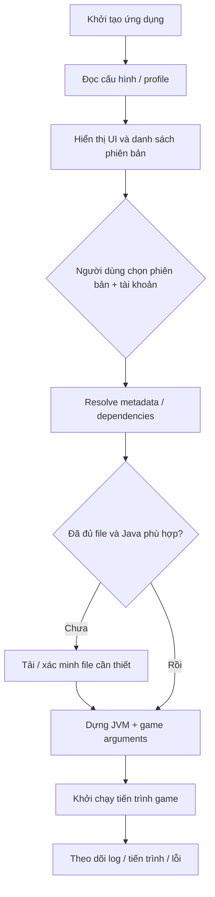

# TLauncher — MECHANICS v0.1 (giai đoạn nghiên cứu, CHƯA BUILD)

**Nguồn:** `re tlaucher.zip` (dữ liệu Craft Anything Study được gửi ngày 13/11/2026). **Phạm vi:** phân tích tĩnh bằng chứng đã xuất; không chạy EXE; không có EXE hoặc database Ghidra trong ZIP. **Trạng thái:** *Chưa đủ chứng cứ để tái dựng logic hoạt động*. Tài liệu này là danh sách giả thuyết cần xác minh, KHÔNG phải đặc tả TLauncher đã được chứng minh.

## 1. Những dữ kiện đã có bằng chứng

| Phát hiện | Bằng chứng | Mức độ |
|---|---|---|
| File mục tiêu `TLauncher.exe`, Windows PE 64-bit x86_64; entry point `0x1421ba730` | `ev_65f88fc9…`, `ev_12919a19…` | Đã ghi nhận từ công cụ |
| SHA-256 do công cụ ghi nhận: `c053b982e7ed3ab28eddcc1c74f418bdea7425e1462535a319fde6b2f73197b2` | 5 evidence JSON | Đã ghi nhận, chưa tự tính lại vì thiếu EXE |
| 8 PE sections, trong đó `.text` ~35,38 MB và `.svm_hea` ~35,26 MB | `ev_3c022a6b…` | Đã ghi nhận |
| Bảng exports 702 symbol; đã xuất 200, trong đó có `IsolateEnterStub__JavaMainWrapper__run`, `JNI_OnLoad_javafx_font`, `JNI_OnLoad_prism_d3d` | `ev_63647226…` | Đã ghi nhận |
| Khả năng là GraalVM Native Image chứa Java/JavaFX runtime | Tên section + exported functions | Suy luận mạnh, chưa xác minh code ứng dụng |
| 37.349 hàm, 193.969 chuỗi được công cụ phát hiện; 621 imports / 35 thư viện | `ev_12919a19…` | Số đếm, KHÔNG phải nội dung logic đã xuất |
| Công cụ dừng phát hiện hàm tại hạn mức ~6 triệu instructions, 100 indirect jumps chưa giải quyết | `ev_12919a19…` | Phân tích có giới hạn |
| Chưa có source code build, decompile đặc thù, screenshot giao diện hay kết luận an toàn | `app/` rỗng; `findings.md` và `handoff.md` chưa có kết quả | Đã kiểm tra ZIP |

## 2. Bản đồ logic cần điều tra (tất cả CHƯA được chứng minh)

| ID | Luồng cần hiểu | Các câu hỏi cần trả lời chính xác | Chứng cứ đạt yêu cầu |
|---|---|---|---|
| L01 | Khởi động launcher | Entry point → hàm ứng dụng nào? Có kiểm tra phiên bản, khóa phiên chạy, khởi tạo cấu hình, tự cập nhật? | Call graph, pseudo-code hàm liên quan, key config và đường dẫn file |
| L02 | Khởi tạo UI | Framework JavaFX được dùng như thế nào? Những màn hình nào? Điều hướng/sự kiện và state ra sao? | Screenshot mỗi màn hình + chuỗi/UI resources + handler tham chiếu |
| L03 | Tài khoản / phiên đăng nhập | Chế độ tài khoản gì (Microsoft, nội bộ, offline)? Token được lấy/lưu/làm mới thế nào? Có gọi server trung gian không? | Domain, HTTP method/paths, luồng OAuth, cấu trúc config (đã lược bỏ bí mật) |
| L04 | Tìm và chọn bản Minecraft | Nguồn danh sách phiên bản? Vanilla/snapshot/mod loaders hỗ trợ gì? Quy tắc hiển thị, lọc và profile? | URL manifest, cấu trúc dữ liệu version, code bộ lọc, UI |
| L05 | Quản lý Java và JVM | Chọn Java tự động hay tùy chọn? Quy tắc phiên bản Java, RAM, flags, OS/arch? | Paths, cấu hình, pseudo-code chọn runtime và dựng lệnh |
| L06 | Cài đặt và cập nhật phiên bản | Phân giải metadata, tải client/libraries/assets, kiểm tra checksum, retry/resume, giải nén natives? | Chuỗi URL, manifest mẫu, mã xử lý tải xuống, folder layout |
| L07 | Khởi chạy game | Classpath, mainClass, gameArgs/JVM args, quyền thư mục, biến môi trường, tiến trình con và log? | Pseudocode dựng command, process execution callsite, ví dụ argv đã ẩn token |
| L08 | Modpack / mod loader | Có Forge/Fabric/OptiFine hay mod riêng? Cách quản lý xung đột và update? | Cài đặt/manifest thực, điểm gọi code, UI có chứng cứ |
| L09 | Cập nhật launcher | Tự kiểm tra/cập nhật EXE? File lưu ở đâu? Chữ ký/hash có kiểm tra không? | Endpoints, logic version compare, file writes, rollback |
| L10 | Network / telemetry / quảng cáo | Những hostname nào? Có telemetry, quảng cáo, tải module động, proxy hoặc kết nối không cần thiết? | Endpoints gắn xrefs, lý do request, dynamic observations (VM) |
| L11 | Persistence / hành vi hệ thống | Tạo Scheduled Task, Run key, Startup shortcut, service, firewall rule hoặc thay đổi security settings không? | API callsites, registry paths, filesystem actions, dynamic log (VM) |
| L12 | Lỗi, phục hồi và cập nhật state | Download fail, hash fail, login expired, Java missing, mạng lỗi, crash xử lý thế nào? | UI states, error strings, control flow, retry behavior |

### Luồng ứng dụng THAM CHIẾU, chưa xác nhận là logic TLauncher

Sơ đồ trên chỉ là bộ khung dùng để đặt câu hỏi khi reverse-engineering, **không được dùng làm bằng chứng về cách EXE đang hoạt động**.

## 3. Điều tra ưu tiên, không lãng phí token API

**P0 — Tìm code ứng dụng:** lấy file EXE gốc để phân tích offline, giữ SHA-256; định vị `IsolateEnterStub__JavaMainWrapper__run` → trace call graph tới app main; lọc runtime JavaFX/GraalVM khỏi code launcher. Tìm strings theo hostname/URL, `minecraft`, `launcher`, `profile`, `version`, `assets`, `library`, `auth`, `java`, `download`, `update`, `settings`, `log`, `reg`, `schtasks`. Sau đó dùng xrefs và pseudocode cho các cụm hàm thật sự liên quan. *Không cần* in 37K hàm hay 194K strings.

**P1 — Giao diện và hành vi:** chụp các màn hình từ môi trường thử nghiệm an toàn (nếu chạy bản nghi vấn, dùng máy ảo cách ly, không dùng tài khoản thật). Ghi lại từng click → thay đổi state → file/network/process. Nếu có thể, xuất resources trực tiếp bằng công cụ đọc PE không bị giới hạn 64 MiB; `native_pe_resources_list` trước đó thất bại vì file ~68,8 MiB vượt giới hạn 64 MiB của riêng tool.

**P2 — Đánh giá an toàn:** lập danh sách mọi endpoint, file/config writes, registry/task/service changes, child-process spawn và auto-update. Phân loại **cần thiết / tùy chọn / không giải thích được**. Không kết luận malware chỉ từ imports (`WINHTTP.dll`, `CRYPT32.dll`) hoặc tên section.

## 4. Quy tắc xác nhận cơ chế trước khi xây lại

Với mỗi luồng L01–L12, ghi: **trigger → inputs → validation → state changes → filesystem/network/process effects → outputs → error branches → evidence IDs**. Trạng thái chỉ được đặt `verified` khi có bằng chứng cụ thể (pseudocode + xref, screenshot hành vi, metadata/file thực hoặc dynamic trace an toàn); nếu chưa có đặt `unknown` hoặc `hypothesis`. Không lấy suy đoán chức năng game launcher làm sự thật của TLauncher.

**Điều kiện bắt đầu Build:** tối thiểu L01–L07 có đặc tả và chứng cứ rõ, L10–L11 đã rà soát hành vi rủi ro, phạm vi mod loader được chốt, UI chính có ảnh, và danh sách unknown/giả định được xác nhận. Triển khai clean-room Rust + eframe/egui; không bê mã decompile, brand/assets độc quyền, token người dùng hoặc hành vi đáng ngờ.

## 5. Thiếu gì ở lần bàn giao này?

- Bản nhị phân `D:\tlaucher\TLauncher.exe` (~72.155.352 bytes) không nằm trong ZIP.
- Database/cache Ghidra không có trong ZIP; ghi nhận `Study Done` không chứng minh DB đã được xuất.
- Evidence chỉ là phân loại PE và danh sách một phần exports; chưa có tìm chuỗi có mục tiêu, cross-references, flow/UI, mạng hoặc filesystem.

**Việc tiếp theo:** cung cấp EXE gốc (hoặc trích xuất Ghidra có xrefs/pseudocode cho các luồng L01–L12) để xác minh. Chỉ sau đó mới hoàn thiện `MECHANICS.md` và `mechanics.json` thành contract thực sự cho Build.