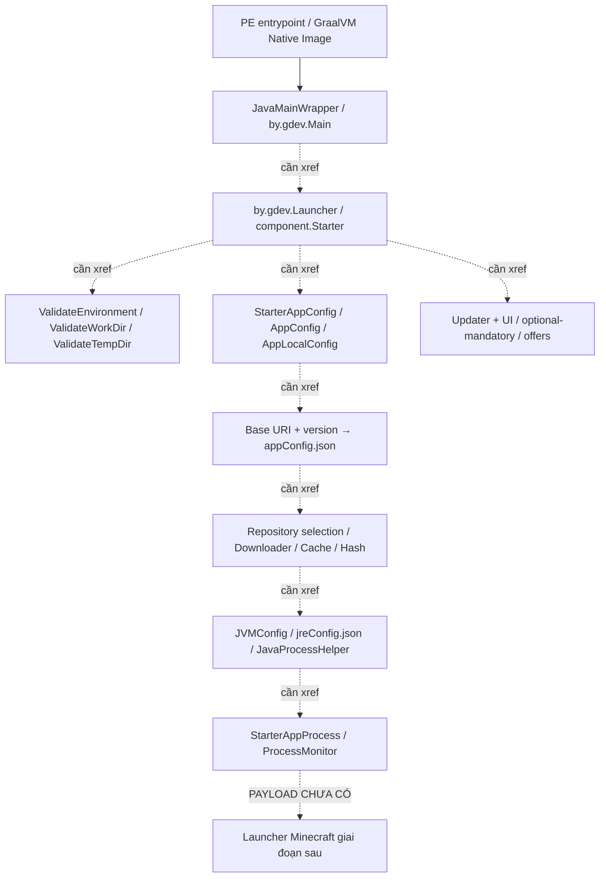

# TLauncher.exe — Reverse-engineering Mechanics (Static v1.0)

**Ngày kiểm tra:** 13/11/2026  · **Trạng thái:** RESEARCH ONLY — **CHƯA BUILD**  · **Nguồn:** `TLauncher.exe` người dùng cung cấp và archive Study của Craft Anything (`re tlaucher.zip`).

**Quy tắc chứng cứ:** `[DIRECT]` = đọc được trực tiếp trong binary/metadata; `[SUPPORTED]` = nhóm chức năng có các lớp + chuỗi tương ứng, chưa chứng minh call graph; `[INFERRED]` = thứ tự/tác động suy đoán, cần kiểm tra; `[UNKNOWN]` = chưa có bằng chứng. Mỗi `E###` đối chiếu file JSON đi kèm, chứa `file_offset`, `section`, `RVA`, `VA`.

> **Kết luận lớn nhất:** file 68,8 MiB được đưa vào phân tích rất có khả năng là **TLauncher Starter/Updater**, không phải toàn bộ client launcher quản lý Minecraft. Tìm thấy các lớp dành cho bootstrap, tải/cập nhật, chuẩn bị Java và chạy tiến trình tiếp theo, nhưng không có đủ bằng chứng về login Microsoft/TLauncher, phiên bản Minecraft, Forge/Fabric, asset resolver và game JVM arguments. Để reverse-engineer **logic Minecraft thực**, phải thu thêm thành phần mà Starter lấy từ repository/cấu hình và sau đó khởi chạy.

## A. Danh tính file và tính toàn vẹn

| Trường | Kết quả và nguồn |
|---|---|
| File | `TLauncher.exe`, **72.155.352 bytes** (68,81 MiB) |
| SHA-256 | `c053b982e7ed3ab28eddcc1c74f418bdea7425e1462535a319fde6b2f73197b2` — đã tính lại trực tiếp |
| Kiến trúc | PE32+ Windows x64, GUI subsystem, 8 section |
| Entry point | `0x1421BA730` (VA) |
| PE COFF timestamp | 2026-08-29 08:56:10 UTC — metadata trong PE, không phải bằng chứng chắc chắn thời điểm phát hành |
| FileVersion / ProductVersion (VERSIONINFO) | `1.268.0.0` |
| Tên internal native image | `starter-core-1.269-native.exe` tại `0x0224D4E4` — *khác với file version*, không tự kết luận bản launcher là 1.269 |
| Toolchain | Dấu vết `com.oracle.svm.core.VM.Target.CCompiler=cl\|microsoft\|x64\|19.51.36248`, `.svm_hea`, `IsolateEnterStub__JavaMainWrapper__run`, JavaFX JNI: dấu hiệu **GraalVM Native Image + MSVC + JavaFX** |
| Authenticode | Có PKCS#7 embedded; subject trong chứng thư: `TLauncher Inc.`; CA: `Certum Code Signing 2021 CA`. **Chưa kiểm tra cryptographic signature và trust chain**, không được xem đây là chứng nhận an toàn. |
| Phân tích | Chỉ đọc file tĩnh, `objdump`, Python byte scanner, OpenSSL certificate parser. **Không thực thi EXE, không gửi request tới các domain.** |

Dữ liệu Craft Anything trước đó ghi nhận 37.349 hàm/193.969 chuỗi bằng Ghidra. Đây là **số đếm** chứ không phải source code đã được cung cấp. Scan ASCII độc lập với minimum 6 ký tự ở lần kiểm tra này tìm được 174.836 đoạn — số đo khác phương pháp, không thể so sánh trực tiếp.

## B. Bản đồ thành phần thấy được trong native image

Các tên lớp `by.gdev.*` bên dưới là bằng chứng trực tiếp, còn quan hệ mũi tên là **luồng làm việc dự kiến để truy vết** (chưa decompile từng phương thức):



**Các lớp tiêu biểu** (danh sách rộng hơn trong `by_gdev_class_inventory.csv`):

| Vai trò dự kiến | Lớp đã xuất hiện trong EXE | Chứng cứ |
|---|---|---|
| Entry/bootstrap | `by.gdev.Main`, `by.gdev.Launcher`, `by.gdev.component.Starter` | E002–E004 |
| Settings/models | `StarterAppConfig`, `AppConfig`, `AppLocalConfig`, `JVMConfig` | E007–E013, class inventory |
| Validation | `ValidateEnvironment`, `ValidateWorkDir`, `ValidateTempDir`, `ValidatedPartionSize`, `X32Interceptor` | E047–E051 |
| Repositories | `InternetServer`, `InternetServerMap`, `InternetServerMapComparator`, `Repo`, `JvmRepo`, `Metadata` | class inventory |
| HTTP & tải | `HttpClientConfig`, `HttpServiceImpl`, `DownloaderImpl`, `DownloadRunnableImpl`, `FileCacheServiceImpl`, `ArchiveHandler`, `GsonServiceImpl` | E022–E026, inventory |
| Kiểm tra lỗi file | `HashSumAndSizeError`, `StatusExeption` | E027–E028, inventory |
| Runtime/child process | `JavaProcessHelper`, `StarterAppProcess`, `ProcessMonitor` | E014–E016 |
| Updater UI | `UpdateCore`, `Update`, `UpdaterDTO`, `UpdaterFormController`, `UpdaterMessageView`, `ProgressStage` | E030–E035, inventory |
| Offers | `Offer`, `PointOffer`, `InstalledOffer`, `InstallOfferList` | E036–E040, inventory |

### L01 — Khởi động / bootstrap

**[DIRECT]** Native entrypoint nằm tại `0x1421BA730`. Disassemble vài lệnh đầu cho thấy gọi tới `0x1421BB390` rồi nhảy tới `0x1421BA5B0`. Có `IsolateEnterStub__JavaMainWrapper__run`, cùng `by.gdev.Main`, `by.gdev.Launcher` và `by.gdev.component.Starter`.

**[SUPPORTED]** Chương trình chứa runtime Java/JavaFX chạy dưới dạng native image. **[UNKNOWN]** Chưa có decompiler/xref đủ để nối trực tiếp các native call tới `Main` → `Launcher` → `Starter`, chưa rõ tham số, init order, singleton lock, nhánh thoát.

### L02 — Working directory, cấu hình và chọn version

**[DIRECT — chứng cứ rất mạnh]** Đoạn mô tả plain text tại offset `0x029259E0` nêu rõ thứ tự ưu tiên xác định working directory:

1. `StarterAppConfig.workDirectory`.
2. `work.dir` trong `installer.properties`.
3. Mặc định: `DesktopUtil.getSystemPath` (định nghĩa trong `by.gdev.Main`).

Đây là **mô tả logic đã nhúng vào binary**, nhưng chưa xác nhận mọi nhánh có thực hiện đúng như mô tả trong mọi lần chạy.

**[DIRECT]** Một chuỗi khác tại `0x029328C8` mô tả một URI thư mục chứa `appConfig.json` và URI cần kết thúc bằng `/`. Chuỗi `0x02934330` nói có thể chỉ định **phiên bản ứng dụng cụ thể**, với ví dụ `http://localhost:81/app/1.0/appConfig.json`; localhost là URL ví dụ trong tài liệu CLI, **không phải endpoint production**.

Tên file xuất hiện: `starter.json`, `appConfig.json`, `jreConfig.json`, `tlauncher-2.0.properties`, `installer.properties`, `starterUpdateV2.json`, `additionalUpdateConfiguration-1.4.json`. Chưa có nội dung JSON hay schema đầy đủ; không tự sáng tác các field.

### L03 — Repository selection, failover và network

**[DIRECT]** Có 4 chuỗi repository rõ ràng:

| File offset | URL embedded |
|---|---|
| `0x02A302D8` | `https://repo.tlauncher.ru/tlauncher-sources/prod/release/tlauncher/` |
| `0x02A30330` | `http://advancedrepository.net/tlauncher-sources/prod/release/tlauncher/` |
| `0x02A30388` | `https://repo.fastrepo.org/tlauncher-sources/prod/release/tlauncher/` |
| `0x02A303E0` | `https://repo.tlauncher.org/tlauncher-sources/prod/release/tlauncher/` |

Tại `0x02934228` có đoạn mô tả danh sách URL dùng cho request và skip máy chủ không có sẵn. Có các địa chỉ `/check.bin` của `stat.tlauncher.ru`, `resource.tlauncher.org`, `repo.tlauncher.org`, `stat.fastrepo.org`, v.v. **[INFERRED]** Có thể dùng check.bin để đo reachability trước khi chọn server, nhưng chưa xác nhận call path, phép đo hay thứ tự ưu tiên.

**Lưu ý bảo mật:** chứa URL **HTTP plaintext** trên `advancedrepository.net`. Chưa xác định chương trình có thực gọi endpoint này không, có buộc xác minh checksum/chữ ký cập nhật trước khi dùng không.

### L04 — Downloader, cache, integrity và lock

**[DIRECT]** Xuất hiện các lớp tải file, file cache, JSON parser, archive, HTTP service và lỗi `HashSumAndSizeError`. Bản dịch thông báo có `upload.error.hash.sum` và `download.lock.message`.

**[SUPPORTED]** Ít nhất thiết kế có chức năng: tải qua HTTP(S), cache, giải archive và phát hiện mismatch hash/kích thước; UI cảnh báo khi một lượt download khác đang hoạt động hoặc lượt trước thoát lỗi.

**[UNKNOWN]** Chưa rõ thuật toán checksum (SHA-1/SHA-256/khác), retry/backoff, resume, atomic rename, đường dẫn output, kiểm soát zip-slip, quyền file và khả năng chống thay đổi dữ liệu trên mạng.

### L05 — Java runtime / JRE

**[DIRECT]** `JVMConfig`, `JvmRepo`, `jreConfig.json`, `DownloaderJavaContainer` và `JavaProcessHelper`.

**[SUPPORTED]** Starter có module dành cho runtime Java và khả năng chuẩn bị Java cho ứng dụng con. **[UNKNOWN]** Version Java, cách chọn/tải/kiểm hash JRE, JVM flags, kiểm OS/architecture, thời điểm dọn JRE cũ.

### L06 — Chạy tiến trình ứng dụng con

**[DIRECT]** `StarterAppProcess`, `JavaProcessHelper`, `ProcessMonitor`, `LinuxExecutor`, `MacExecutor`, `WindowsExecutor`.

**[SUPPORTED]** Code có abstraction để khởi chạy ứng dụng và theo dõi process trên các OS (dù EXE đang phân tích là Windows x64). **[UNKNOWN]** Không có command line thực tế; chưa chứng minh child là JAR/game client hay một EXE khác; chưa có exit-code handling, STDOUT/STDERR capture, timeout hay quyền elevation.

**Điều kiện hoàn thiện:** phải tìm **binary/JAR thực tế chạy sau Starter**, theo dõi command line đã ẩn token và truy vết logic ở thành phần đó.

### L07 — Cập nhật starter/ứng dụng

**[DIRECT]** Có hai chuỗi UI: `launcher.update.message.mandatory` (**mandatory**) và `launcher.update.message.optional` (**optional**), nút `Remind me later`, text `update.app` so sánh current version/new version, `UpdateCore`, `UpdaterFormController`, `starterUpdateV2.json`, `additionalUpdateConfiguration-1.4.json`.

**[SUPPORTED]** Thiết kế có phân nhánh mandatory/optional, UI xác nhận và thông báo cập nhật ứng dụng. **[UNKNOWN]** Điều kiện mandatory, nguồn metadata, xác minh chữ ký tải xuống, download file tạm/replace/rollback và xử lý update lỗi.

### L08 — Third-party offers / điều khoản kèm updater

**[DIRECT]** `accept.and.update=Accept offer and Update` tại `0x02763560`, `decline.and.update=Decline offer and Update` tại `0x02763533`; các lớp `Offer`, `InstalledOffer`, `PointOffer`, file `installedOffers.json`.

**[SUPPORTED]** Có một flow UI liên quan việc đồng ý/từ chối offer khi update. **[UNKNOWN]** Nội dung offer, người dùng có đồng ý rõ ràng không, mặc định chọn gì, offer có cài chương trình bổ sung hay không. **Không gọi đây là malware nếu chưa quan sát được hành vi.** Nhưng đây là luồng có ưu tiên kiểm toán bảo mật cao.

### L09 — Kiểm tra môi trường

**[DIRECT]** Các lớp `ValidateEnvironment`, `ValidateWorkDir`, `ValidateTempDir`, `ValidateTempNull`, `ValidatedPartionSize`, `X32Interceptor`, `ValidateUpdate`. Resource messages mô tả lỗi quyền truy cập working directory, TEMP/TMP sai, dung lượng đĩa thiếu, 32-bit, lỗi tải file.

**[SUPPORTED]** Nhiều khả năng check cấu hình hệ thống trước khi tải/chạy. **[UNKNOWN]** Thứ tự check, tình huống chặn hoàn toàn hay chỉ cảnh báo, quyền quản trị/registry.

### L10 — UI, ngôn ngữ, log

**[DIRECT]** JavaFX JNI, các `application_*.properties`, ảnh `/newTlauncher.png`, chuỗi UI `Updater`, `Preparing`, `Get log link`, `Log link copied to clipboard`. Có điều khiển giao diện như `UpdaterMessageView`, `RoundUpdaterButton`, `OwnImageCheckBox`.

**[SUPPORTED]** EXE có UI **starter/updater**, không có bằng chứng đủ để dựng lại màn hình chọn Minecraft, đăng nhập hoặc tab mod. UI localization là multilingual, có tiếng Anh. Không khẳng định logo/asset nào có quyền dùng lại.

### L11 — Security/telemetry — phân loại để kiểm tra thêm

| Chứng cứ | Kết luận an toàn được phép rút ra | Chưa được phép kết luận |
|---|---|---|
| `https://stat.fastrepo.org/updater/save` (E041) | Có endpoint tên đường dẫn giống ghi nhận updater | Chắc chắn gửi dữ liệu người dùng, có telemetry active |
| HTTP repository (E018) | Có cấu hình endpoint không TLS | Chắc chắn từng tải file qua HTTP hoặc bị MITM |
| `installedOffers.json`, UI Accept/Decline | Có logic dữ liệu/UI liên quan offers | Cài đặt adware tự động hoặc không có consent |
| PE chứa imports WinHTTP, Crypto, Registry | Có khả năng gọi API tương ứng | Có hành vi độc hại hoặc đã sửa registry |
| Chứng thư `TLauncher Inc.` | Có PKCS#7 ký mã được đính kèm, subject là TLauncher Inc. | Chữ ký còn hợp lệ, binary an toàn, CA đang được hệ thống tin tưởng |

**Chưa có hành vi runtime:** không có packet capture, process tree, Procmon, registry/file diff, pseudocode của callsite. Vì vậy *chưa thể kết luận file sạch hay độc hại*.

### L12 — Minecraft account, versions, downloads, game launch, Forge/Fabric

**[UNKNOWN]** Tìm thấy một URL `https://launchermeta.mojang.com/.../pre-1.6.json` tại `0x02960720`. Đây là bằng chứng có tham chiếu tới metadata Mojang, nhưng có thể chỉ là tài nguyên thư viện/đoạn ví dụ; không chứng minh chương trình này tự quản lý toàn bộ game.

Trong scan chuỗi ASCII nhắm mục tiêu, `minecraft` chỉ xuất hiện rất ít; không tìm thấy token rõ ràng cho `authlib`, OAuth, Modrinth hay OptiFine (các từ như `forge`/`fabric` phần lớn thuộc Public Suffix List hoặc thư viện). **Đây không phải bằng chứng phủ định chức năng.** GraalVM có thể đóng gói/biến đổi chuỗi, và thành phần tải về có thể chịu trách nhiệm chính. Không vẽ flow Microsoft login hoặc Minecraft launch như đã verify.

## C. Tổng hợp tình trạng logic — trước Build

| Luồng | Trạng thái | Đã đủ để viết y nguyên TLauncher? |
|---|---|---|
| L01 Starter / bootstrap | Cấu trúc rõ, thiếu call graph | Chưa |
| L02 Config / version resolution | **Có mô tả thứ tự working dir** + base config | Một phần |
| L03 Repository discovery | Có URL và mô tả failover | Một phần |
| L04 Download / verify | Các thành phần rõ, thiếu thuật toán | Chưa |
| L05 JRE provisioning | Có model/JSON, chưa rõ rule | Chưa |
| L06 Child process launch | Có class, thiếu command line | Chưa |
| L07 Update | Có phân nhánh UI, thiếu thực thi | Chưa |
| L08 Offer | Có nút opt-in/decline, thiếu side effects | Chưa |
| L09 Environment validation | Có class và UI errors | Một phần |
| L10 UI starter | Có JavaFX & localization; không có gameplay UI | Chưa |
| L11 An toàn / telemetry | Chưa quan sát runtime | Chưa |
| L12 **Logic Minecraft thật** | **Chưa có payload** | **Chưa** |

### Quy trình cần điều tra tiếp theo (không Build)

1. **Lấy payload giai đoạn sau**: file `appConfig.json` và JAR/EXE ứng dụng mà Starter tải hoặc chạy. Đọc kết quả cài đặt sẵn trên máy, không cần khởi chạy lại TLauncher nếu đã có cache. Từ URL base + `appConfig.json`, xác minh metadata và tên file; cần scrub credentials/tokens nếu chia sẻ cấu hình.
2. **Phân tích Java payload** (nếu là JAR): danh sách package/class, manifest entry point, HTTP endpoints, XML/JSON configs, flows auth/profile/version/assets/Java/launch. Xác định rõ original features vs library.
3. **Truy dấu native call** cho `by.gdev.Main`, `Launcher`, `Starter`, `UpdateCore` bằng Ghidra project nếu có hoặc pseudocode xuất ra, ưu tiên xrefs tới các chuỗi cụ thể nêu trong evidence, không quét lại toàn bộ runtime.
4. **Quan sát có kiểm soát** trong VM cách ly nếu cần: DNS/HTTP(S) metadata, process tree, file writes, update offers và xác thực/checksum. Không dùng tài khoản game thật hoặc cấp quyền admin không cần thiết.
5. **Hoàn thành contract** theo mẫu `trigger → input → validation → state changes → filesystem/network/process effects → outputs → error branches → evidence IDs` cho mỗi luồng trước khi Build.

**Cổng quyết định:** `NOT READY FOR FULL REBUILD` cho đến khi L12 và phần thực thi giai đoạn sau đủ bằng chứng. Có thể mô tả kiến trúc starter nhưng không nên lập trình game launcher dựa trên suy đoán.

## D. Cách lấy thêm dữ liệu trên Windows — chỉ đọc, không chạy EXE

Nếu TLauncher từng được mở trên máy, hãy tìm các file có thể là payload trong **thư mục dữ liệu TLauncher đã tồn tại**. Mở PowerShell, chạy từ thư mục nghi có dữ liệu (không quét toàn bộ ổ C nếu không cần):

```powershell
$root = 'D:\tlaucher'   # đổi thành thư mục TLauncher đang lưu file tải/cài
Get-ChildItem -LiteralPath $root -Recurse -File -ErrorAction SilentlyContinue |
 Where-Object { $_.Name -match '\.(jar|json|properties)$' } |
 Select-Object FullName,Length,LastWriteTime |
 Sort-Object FullName
```

Với ứng dụng đã cài, có thể xem thư mục dưới `%APPDATA%`/`%LOCALAPPDATA%` có tên liên quan TLauncher, nhưng **không khẳng định đường dẫn nào là của bản này**. Gửi JAR/EXE payload (nếu có) và cấu hình đã loại bỏ token, cookie, mật khẩu, thông tin tài khoản, server riêng tư. Không cần gửi toàn bộ `.minecraft` hoặc hồ sơ người dùng.

## E. Tính tái lập và giới hạn

- Chi tiết 57 evidence có offset, RVA, bytes gốc: `TLauncher_mechanics_static_v1.json` / `evidence_index.json`.
- 115 tên `by.gdev.*` rút từ chuỗi (chứa cả interface/lambda và một số hậu tố do cách lưu native image): `by_gdev_class_inventory.csv` — **không phải call graph**.
- Việc giải mã certificate chỉ chứng minh cấu trúc PKCS#7 và subject/issuer. Chưa kiểm chữ ký số, thu hồi, timestamp signing hoặc sự tin cậy của certificate.
- Đường dẫn và URL embedded **không đồng nghĩa đã được ứng dụng thực sự sử dụng**; file `.svm_hea` chứa cả runtime và tài nguyên thư viện.
- Không chạy EXE, không giải mã traffic TLS, không sửa/xóa file gốc, không dùng tài khoản người dùng.

**Không có code application nào được Build ở vòng này.**