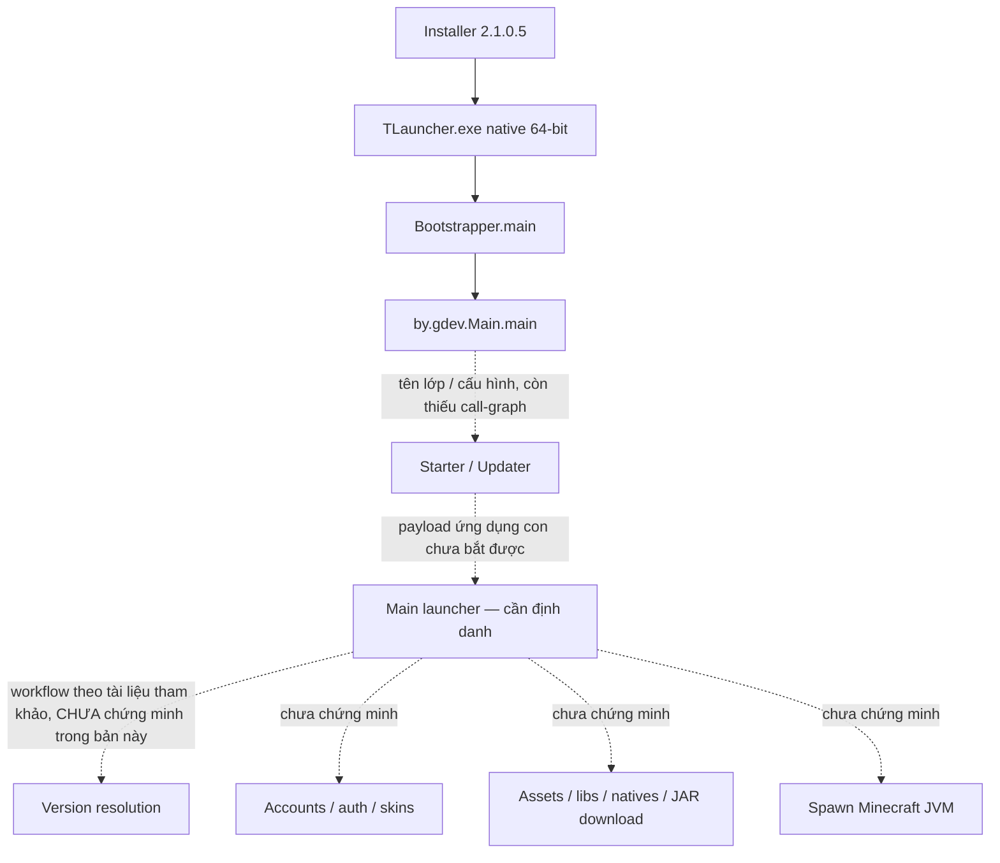

# TLauncher — Đối chiếu tài liệu tham khảo với bằng chứng đã kiểm tra (v2)

**13/11/2026 · RESEARCH ONLY · CHƯA BUILD**

## Phạm vi và nguồn

- EXE thực tế: `TLauncher.exe`, PE x64, 72.155.352 bytes, SHA256 `c053b982e7ed3ab28eddcc1c74f418bdea7425e1462535a319fde6b2f73197b2`.
- Installer thực tế: `TLauncher-Installer-2.1.0.5.exe`, 103.089.568 bytes, SHA256 `25189514c0b7739bf5549331fec12db48ab694770cd20d5f2b23057e73fd1e17`.
- Báo cáo đã tạo: `TLauncher_MECHANICS_STATIC_v1.md` và `TLauncher_mechanics_static_v1.json`.
- Tài liệu người dùng bổ sung: *Văn bản đã dán (1)(20261113-103543).txt* (giống hệt hai bản text trước đó, SHA256 `8d7b32d01b3513e92da64c6da2e1d259c8d3ca6ffe6166e1db1c0e6085b6fae8`).
- GitHub nguồn thứ ba: https://github.com/helloworld2468/TLauncher-Source-Code (tồn tại; có ZIP `original-TLauncher-2.923.zip`, 3,18 MB). **Chưa mở được nội dung bên trong ZIP từ phiên làm việc hiện tại**; chưa xác thực cây lớp, tính nguyên gốc hoặc sự tương thích với EXE 2026.
- Dự án khác: https://github.com/LegacyLauncher/archive (archive mã nguồn Legacy Launcher, *không phải* cùng một nhánh source code với `tlauncher.org`).

## Phân tách chương trình đúng theo bằng chứng

**Bằng chứng đã xác nhận:** Installer có Java bytecode `Bootstrapper.main(args)` gọi `by.gdev.Main.main(args)`. EXE có dấu hiệu GraalVM Native Image, JavaFX, các tên lớp `by.gdev.*`, repo URL, updater, downloader, process helper. Thứ tự gọi tất cả các lớp tiếp theo **chưa chứng minh** bằng call graph đầy đủ.

## Đối chiếu nội dung tài liệu tham khảo

| Chủ đề | Tài liệu người dùng nêu | Phán định đối với EXE đã cung cấp | Cần làm để kiểm chứng |
|---|---|---|---|
| Version manifest | `VersionManager`, `VersionSyncInfo`, Mojang + TLauncher repo | **Cơ chế Minecraft phổ biến; chưa xác nhận trong payload EXE**. Starter có repo URL, không đủ chứng minh cách tạo danh sách game. | Đọc source Java 2.923 và payload launcher hiện tại; xác minh request/merge/filter cache |
| Download content | Client JAR, libraries, natives, assets, SHA-1 | **Mô hình chuẩn khả dĩ**, nhưng `HashSumAndSizeError` trong EXE chỉ xác nhận tên lớp, không chứng minh thuật toán hay đường dẫn của Minecraft | Truy vết manifest parser, resolver, hash verification, retry, file writes |
| Account/offline mode | `Account`, UUID, token `0`, login | **Chưa xác minh trong bản EXE** | Kiểm tra Account/Auth implementation; xác nhận hỗ trợ Microsoft và trường hợp offline |
| Skin override | `org.tlauncher.authlib`, `tl_skin_cape` | **Giả thuyết dựa trên tài liệu**, chưa xác minh bản hiện tại | Kiểm tra library resolution, URL, hash, cách can thiệp authlib và file mods |
| Modpacks | Tách thư mục / `--gameDir` | **Cần kiểm tra riêng**: không tự suy ra đường dẫn/gameDir mặc định | Đọc modpack metadata/installer, version inheritance, run args |
| Khởi chạy game | `ProcessBuilder`/`javaw.exe`, `-cp`, mainClass, args | **Cơ chế Java launcher tiêu chuẩn**; `JavaProcessHelper` hiện thấy là của Starter, không chứng minh nó sinh lệnh Minecraft | Lấy command-builder của launcher chính; kiểm tra version JSON và process command line đã ẩn token |
| Legacy Launcher | GitHub `LegacyLauncher/archive` | **Repository tồn tại, nhưng khác lineage với `tlauncher.org`** | Chỉ dùng tham khảo thuật toán/chất lượng thiết kế, không dùng làm bằng chứng tương đương |
| Decompile 2.923 | `original-TLauncher-2.923.zip` | **Repository và file ZIP có thật**, chưa kiểm tra nội dung ZIP hoặc độ tương thích | Đọc archive rồi đối chiếu package, class, protocol với bản đang nghiên cứu |

## Cảnh báo về code mẫu trong tài liệu

1. **Offline UUID:** `UUID.nameUUIDFromBytes(("OfflinePlayer:" + username).getBytes(UTF_8))` trong Java không tương đương `uuid.uuid3(uuid.NAMESPACE_DNS, f"OfflinePlayer:{username}")` của Python. UUID3 Python băm cả bytes của namespace DNS, trong khi Java mẫu chỉ băm chính byte chuỗi. Không được dùng bản Python đó để khẳng định tương thích.
2. **`mainClass` không nên hardcode** thành `net.minecraft.client.main.Main` cho mọi phiên bản. Cần dùng JSON manifest thực tế, xử lý version inheritance và thay đổi từ mod loaders.
3. **JVM và game args không cố định:** phiên bản hiện đại dùng mảng `arguments` và `rules`; giả định chỉ có `minecraftArguments` sẽ thiếu cấu hình. Không tự thêm JVM flags mặc định nếu không kiểm chứng.
4. **Giá trị token `0`** là ví dụ chế độ offline, không thay thế quy trình đăng nhập/chứng thực hợp lệ khi người dùng chơi online.
5. **Đường dẫn native/cache/modpack** trong tài liệu là ví dụ, chưa phải các đường dẫn xác nhận trên máy người dùng.

## Ưu tiên nghiên cứu (không Build)

**Ưu tiên 1 — định danh ứng dụng chính:** Tìm artifact ở lớp Installer/Starter, cấu hình URI và `appConfig.json`, xác nhận file được chạy sau `by.gdev.Main` (JAR hay native EXE). Không cần chạy EXE trên máy chính để làm việc này.

**Ưu tiên 2 — kiểm tra ZIP decompile 2.923:** Đối chiếu những tên class thực tế có trong ZIP với `VersionManager`, account/auth, resolver, game-process builder; phân loại `MATCH`, `CHANGED`, `ABSENT`, `UNVERIFIED`. Không coi ZIP bên thứ ba là chứng cứ tuyệt đối.

**Ưu tiên 3 — hợp đồng logic từng luồng:** `trigger → config/input → validation → server/file reads → state mutations → output/process → error/retry → evidence`. Tối thiểu gồm bootstrap, update, login, list versions, install, launch, skin/modpack và consent/telemetry.

**Cổng Build:** chưa mở. Không thể khẳng định bản 2.923 phản ánh chính xác binary hiện tại cho tới khi so sánh payload/version và call path.