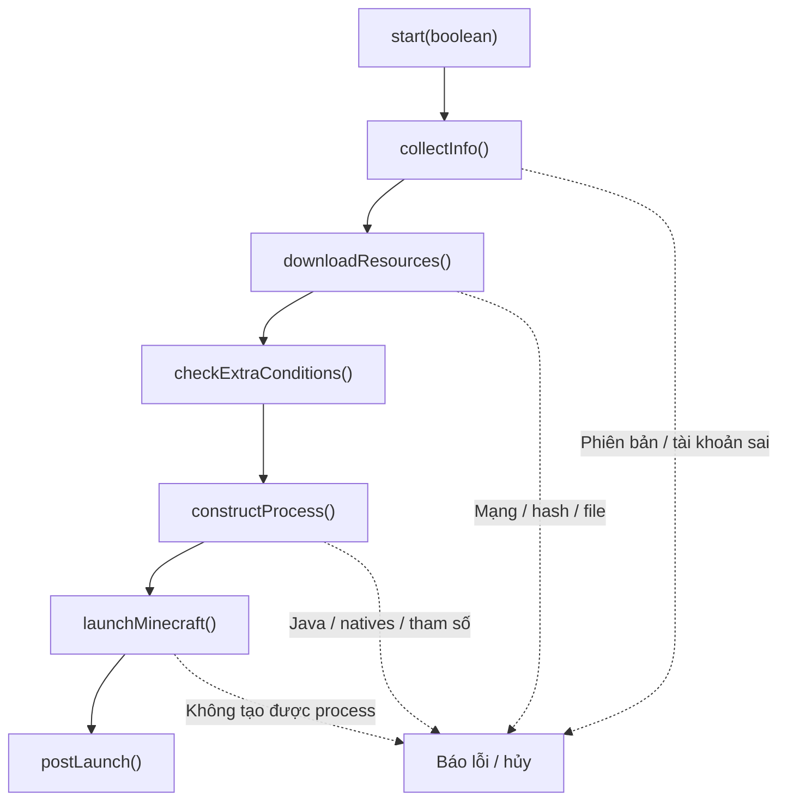
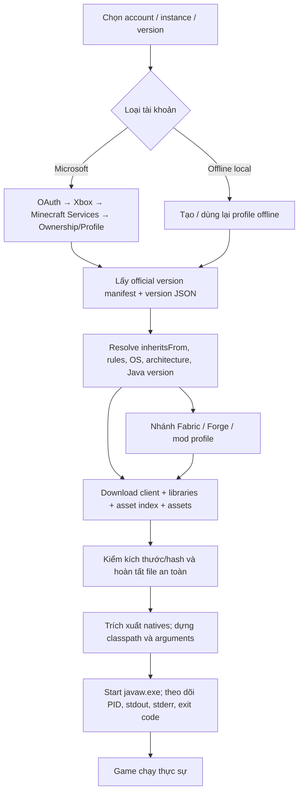

# TLauncher — Reverse-engineering contract v3

**Mục tiêu:** tạo **Minecraft launcher dùng được thật** trên Windows (không phải demo giao diện). **Giai đoạn hiện tại:** nghiên cứu logic; **chưa xây dựng / chưa chạy EXE nghi vấn**.

## 1. Phạm vi và độ tin cậy

| Nguồn | Nội dung | Cách dùng |
|---|---|---|
| `original-TLauncher-2.923.zip` | 1.193 `.class`, 1.415 ZIP entries; bytecode Java và metadata | **Bằng chứng mạnh** về cơ chế bản 2.923; xác minh bằng `javap -c -p` |
| `TLauncher.exe` | PE x64 72.155.352 bytes; dấu vết GraalVM / Starter | Bằng chứng về **Starter 2026**, không đồng nhất với mã 2.923 |
| `TLauncher-Installer-2.1.0.5.exe` | PE bộ cài có payload nhúng | Điều tra khởi tạo/cài đặt, không lấy làm bằng chứng mô tả trực tiếp code launcher 2.923 |
| `tlauncher-2.0.properties` (output PowerShell người dùng) | Khóa cài đặt thực tế | Bằng chứng về cấu hình hiện tại của một máy, không phải toàn bộ hành vi |
| Tài liệu tham khảo `.txt` | Mô hình tính năng do bên thứ ba giải thích | Chỉ là **nguồn gợi ý**; nội dung phải đối chiếu bytecode |

**Cảnh báo phiên bản:** chứng minh tính năng trong bytecode 2.923 **không** đồng nghĩa `TLauncher.exe` 2026 đang chạy cùng bytecode. Chúng có thể là các thế hệ/thành phần riêng.

**SHA256** ZIP tham chiếu: `0e83efed2a35e23fda8ecc87220516b5369e6628f9fd35da4e9082562b52f250`.

## 2. Call flow *đã xác minh* của MinecraftLauncher 2.923

Trong `org/tlauncher/tlauncher/minecraft/launcher/MinecraftLauncher.class`, method `start(boolean)` có các lệnh gọi liên tiếp tại bytecode offset `10`, `14`, `18`, `22`, `26`, `30`:

- `collectInfo()`: đọc phiên bản đã chọn trong configuration, lấy tài khoản từ `ProfileManager.getSelectedAccount()`, tra `VersionManager.getVersionSyncInfo(...)`, resolve `CompleteVersion`, đọc `minecraft.gamedir`, tạo thư mục; có nhánh lỗi nếu thiếu username, version hoặc thư mục.
- `downloadResources()`: `VersionManager.downloadVersion(...)` cho client/libraries; `AssetsManager.downloadResources(...)` cho assets; `ModpackManager.getContainer(...)` cho bản modpack; cùng gọi `Downloader` và các helper khi cần.
- `checkExtraConditions()`: method riêng được gọi trước dựng tiến trình; cần tiếp tục kiểm chứng chi tiết theo từng loại version.
- `constructProcess()`: `TLauncherManager.createUpdatedVersion(...)`, `reconstructAssets()`, `unpackNatives(forceUpdate)`, xử lý entries/libraries, dựng JVM và game arguments, đối chiếu môi trường.
- `launchMinecraft()`: gọi `JavaProcessLauncher.start()` để mở game. Trong `net/minecraft/launcher/process/JavaProcessLauncher.class`, method `start()` gọi `ProcessBuilder.start()` tại bytecode offset **14**, tạo đối tượng `JavaProcess` để quản lý vòng đời.
- `postLaunch()`: xử lý tác vụ sau khi phát lệnh chạy; không được nhầm với bằng chứng game đã nạp màn hình và chơi thành công.

**Đây là pipeline *thật* của bytecode 2.923**, không phải ví dụ tự viết.

## 3. Luồng xác thực thực tế 2.923

### Microsoft — có kiểm tra sở hữu game

Trong `MinecraftOAuthAuthenticate.authenticate(...)`, bytecode có các lời gọi liên tiếp:

1. `MicrosoftOAuthCodeExchanger.exchangeMicrosoftOAuthCode` (offset 5).
2. `XboxLiveAuthenticator.xboxLiveAuthenticate` (17).
3. `XSTSAuthenticator.xstsAuthenticate` (29).
4. `MinecraftServicesAuthenticator.minecraftServicesAuthenticate` (40).
5. `GameOwnershipValidator.checkGameOwnership` (51).
6. `MinecraftProfileRequester.requestProfile` (60).
7. `MinecraftProfileConverter.convertToMinecraftUser` (74).

`MicrosoftAuthenticator.pass()` còn có nhánh làm mới Microsoft token khi hết hạn. `GameOwnershipValidator` dùng endpoint `https://api.minecraftservices.com/entitlements/mcstore`. Điều này chứng minh **không thể coi hiện một màn hình đăng nhập là đã hoàn thành auth thật**.

### Free/Offline — tài liệu tham khảo trước đó có điểm sai

`FreeAuthentication.pass()` kiểm tra UUID của tài khoản. Nếu **chưa có UUID**, bytecode gọi **`UUID.randomUUID()`** (offset 17), chuẩn hóa và lưu vào Account; sau đó đặt user ID và display name. Nếu đã có UUID thì giữ UUID cũ. Vì thế **không** được mô tả bản 2.923 này là luôn tạo `UUID.nameUUIDFromBytes("OfflinePlayer:"+username)`.

**Thiết kế bản thay thế:** hỗ trợ offline/local single-player rõ ràng, tách biệt với Microsoft account; không giả mạo một tài khoản đã sở hữu game và không dùng offline token để vượt xác thực server online-mode.

## 4. Phiên bản, tài nguyên và modpack

| Cấu phần | Bytecode / method đã kiểm tra | Trạng thái |
|---|---|---|
| Danh sách local + remote | `VersionManager.getVersions0()`, `LocalVersionList.getVersions()`, `RemoteVersionList.getVersions()` | **Đã xác minh** merge bản local/remote; chưa đầy đủ chính sách ưu tiên nguồn |
| Chọn / tải version | `VersionManager.downloadVersion(...)`, `VersionSyncInfo.resolveCompleteVersion(...)` | **Đã xác minh** đường gọi tải file phiên bản |
| Assets | `AssetsManager.downloadResources`, `checkResources`, `AssetObject.getHash`, `MetadataDTO.setSha1` | **Đã xác minh** mô hình assets dựa SHA-1; cần kiểm tra toàn bộ nhánh retry |
| JVM args | `MinecraftLauncher.getJVMArguments()` xử lý arguments trong `CompleteVersion` + môi trường, classpath, natives, Java | **Đã xác minh** có xử lý version-specific thay vì hardcode một dòng lệnh |
| Game args | `MinecraftLauncher.getMinecraftArguments()` ánh xạ auth username/token/UUID và argument rules | **Đã xác minh** có builder tham số |
| Download queue | `Downloader.run`, `DownloaderThread.download` và `downloadURL` | **Đã xác minh** có engine tải với luồng riêng; chưa chứng minh mọi chính sách retry/hash |
| Modpacks | `ModpackManager` có `createModpack`, `installEntity`, `removeEntity`, `changeModpackElementState`, `backupModPack`, `installModPack` | **Có bytecode** cho các tính năng; từng endpoint/format cần truy tiếp |
| Skin riêng | `TLauncherManager.applyTLauncherAccountLib`, `ModpackManager.installTLSkinCapeMod` | **Có logic can thiệp đặc thù vendor**; không nhất thiết phải sao chép trong launcher mới |

## 5. Đặc tả luồng vận hành cho launcher mới

Đây là **contract triển khai được đề xuất**, không phải khẳng định bytecode của TLauncher 2026 đã làm y hệt.

**Không chấp nhận** hardcode `net.minecraft.client.main.Main` cho mọi loader; đọc `mainClass`, `arguments`, `rules`, `javaVersion` từ metadata và launcher profile cụ thể.

**Dữ liệu giữ bền:** profiles, installed versions, Java installations, instance mapping, download tasks, asset cache, launch logs, account metadata; secrets phải bảo vệ bằng cơ chế lưu trữ credential của OS.

## 6. Điều kiện nghiệm thu — chỉ được gọi là 'hoạt động thật' khi có bằng chứng

| ID | Kiểm thử trên Windows | Kết quả được coi là PASS |
|---|---|---|
| F01 | Load version manifest Mojang | Danh sách release/snapshot thật; parse đủ version JSON |
| F02 | Cài Vanilla sạch trên thư mục trống | Client, libraries, assets, natives hiện diện; hash/size khớp |
| F03 | Chạy Vanilla bằng Microsoft account có quyền sở hữu | Game mở đến menu; đúng profile; có PID, exit code và log |
| F04 | Mở lại khi mất mạng với file đã có | Cho phép thao tác được hỗ trợ offline và thông báo điều kiện rõ ràng |
| F05 | Download mạng lỗi giữa chừng | Không phá file tốt; retry/resume hoặc tải lại; trạng thái rõ ràng |
| F06 | Cài bản Java yêu cầu runtime khác | Tự chọn Java phù hợp hoặc yêu cầu cài, không ép toàn bộ vào JDK 25 |
| F07 | Install + launch Fabric | Client vào game và Fabric loader được nhận diện |
| F08 | Install + launch Forge (version tương thích) | Classpath và mainClass đúng với metadata Forge |
| F09 | Microsoft OAuth refresh | Không yêu cầu đăng nhập lại vô lý; không để token trong log |
| F10 | Offline local single-player | Hoạt động với game files có sẵn, không giả danh tài khoản Microsoft |
| F11 | Cấu hình RAM, đường dẫn, độ phân giải | Tham số thực tế phản ánh setting được lưu |
| F12 | Modpack tạo/cài/gỡ và độc lập dữ liệu | Các instance không vô tình ghi đè saves/mods của nhau |
| F13 | Launch lỗi Java / corrupt file | Có thông báo nguyên nhân, log, đường khôi phục |
| F14 | Tắt launcher sau khi game chạy | Không kill game ngoài ý muốn; hành vi hide/keep/exit đúng setting |
| F15 | Cập nhật launcher hoặc cấu hình | Có checksum/signature; rollback hoặc phục hồi khi lỗi |
| F16 | Không có telemetry/ads không mong muốn | Không thêm tải quảng cáo, ghi token hoặc sửa authlib ngầm |

### Thứ tự nghiệm thu đề xuất

- **Gate A — Vanilla E2E:** F01, F02, F03, F05, F06, F11, F13. Không PASS thì chưa coi là launcher.
- **Gate B — Identity/Offline:** F04, F09, F10, F14.
- **Gate C — Modded/instances:** F07, F08, F12.
- **Gate D — Release/Security:** F15, F16 và regression trên các phiên bản game mục tiêu.

Đây là acceptance **chưa chạy**; không có mục nào được tự nhận PASS chỉ vì đã tìm thấy method trong bytecode.

## 7. Khoảng trống còn phải giải quyết trước khi Build

1. **Khác biệt giữa bản 2.923 và TLauncher.exe 2026:** làm rõ vùng chức năng thuộc starter, vùng thuộc launcher runtime, khả năng cập nhật module.
2. **JSON/version inheritance và rules mới:** xác thực schema trên manifest Mojang hiện hành.
3. **Installer Forge/NeoForge/Quilt:** mỗi loader có cơ chế build profile khác; không copy tham số Vanilla.
4. **Microsoft OAuth:** ứng dụng mới cần đăng ký client hợp lệ và xử lý token bảo mật; không sử dụng client ID bí mật/khóa của ứng dụng khác.
5. **Tải lại và an toàn file:** cần chứng minh checksum thực thi, temp files/atomic rename, rollback, tránh zip-slip khi giải nén.
6. **TL Mods, skin vendor:** xác định những tính năng nào cần thiết để tương đương hành vi người dùng, nhưng không sao chép mã/asset độc quyền và không thêm cơ chế thay đổi authlib không được đồng ý.
7. **Kiểm thử E2E:** chưa có game được khởi chạy bởi launcher mới; không được tuyên bố “đã hoạt động”.

## 8. Nguồn đối chiếu bên ngoài (không coi là evidence của TLauncher)

- Manifest Minecraft Java: `https://piston-meta.mojang.com/mc/game/version_manifest_v2.json`.
- Mô tả cấu trúc version manifest: `https://minecraft.wiki/w/Version_manifest.json`.
- Fabric metadata API: `https://github.com/FabricMC/fabric-meta`.
- Mô tả luồng Microsoft authentication và quyền hạn app: `https://minecraft.wiki/w/Microsoft_authentication`.

**Kết luận:** ZIP 2.923 cho phép khôi phục **pipeline chương trình thật** khá chi tiết. Nó là reference để thiết kế hành vi tương đương, **không phải toàn bộ source có thể build ngay**, và chưa đủ để khẳng định code 2026 trùng code 2.923. Bước sau là hoàn thiện contract của từng engine và acceptance test, **sau đó mới viết implementation thật**.