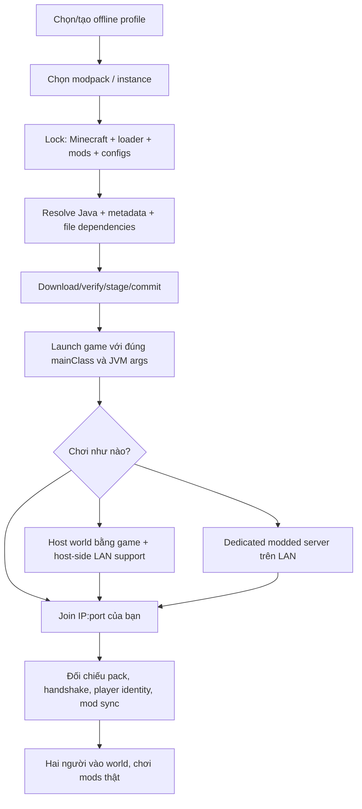
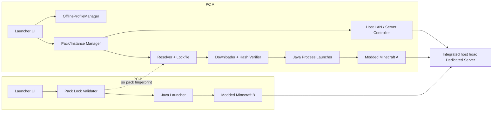

# OFFLINE-LAN Minecraft Launcher — Hồ sơ mechanics v4

**Ngày phân tích:** 13/11/2026  
**Trạng thái:** reverse-engineering và đặc tả; **chưa Build, chưa thử chạy Minecraft bằng launcher mới**.  
**Mục tiêu đã khóa:** profile offline, modpack thực, 2+ máy cùng LAN, không triển khai Microsoft/Premium Login. Không làm bản mock giao diện.

## 0. Phân biệt bằng chứng và thiết kế

- **[BC-2.923]**: đã quan sát lời gọi/hành vi trong bytecode TLauncher 2.923 (file được người dùng cung cấp). `PC` là bytecode offset bên trong phương thức, *không phải* offset của EXE.
- **[BC-EXE]**: nhận diện tĩnh EXE GraalVM/Starter 2026 từ lượt phân tích trước; không tự suy ra code runtime 2.923 trùng 2026.
- **[ĐỐI CHIẾU]**: tài liệu chính thức của Minecraft/Fabric/NeoForge/Modrinth và quy tắc chơi LAN.
- **[THIẾT KẾ]**: hành vi bắt buộc đề xuất cho launcher mới, **chưa hiện hữu** và không được gọi là đã test.

| Nguồn | SHA-256 / kiểm kê | Phạm vi |
|---|---|---|
| `original-TLauncher-2.923.zip` | `0e83efed2a35e23fda8ecc87220516b5369e6628f9fd35da4e9082562b52f250`; 1.415 entries, **1.193 `.class`** | Mô hình code TLauncher 2.923; một số class DTO `org.tlauncher.modpack.domain...` **không nằm trong ZIP** |
| `TLauncher.exe` | `c053b982e7ed3ab28eddcc1c74f418bdea7425e1462535a319fde6b2f73197b2` | Native PE 2026 / Starter; đã có bằng chứng GraalVM, JavaFX, không thay thế bytecode launcher 2.923 |
| `TLauncher-Installer-2.1.0.5.exe` | `25189514c0b7739bf5549331fec12db48ab694770cd20d5f2b23057e73fd1e17` | Bộ cài chứa payload; không chứng minh chức năng mạng/LAN |
| `tlauncher-2.0.properties` | Các khóa được người dùng đọc bằng PowerShell | Chỉ xác minh cấu hình máy người dùng, không chứng minh mọi nhánh chạy |

**Giới hạn chính:** 2.923 là archive bytecode, không phải project hoàn chỉnh dễ build lại: thiếu các class domain/dependency trong chính archive. Không có thực nghiệm LAN, không có dedicated server binary hoặc bộ modpack người dùng trong dữ liệu này. Cần nghiệm thu trên hai Windows thật hoặc VM network cùng subnet.

## 1. Chân dung đúng của launcher cần làm

**Sản phẩm mới** quản lý 3 lớp khác nhau:

1. **Launcher / Instance Manager:** người dùng offline, metadata phiên bản, Java runtime, files, modpack lock, log, UI.
2. **Minecraft client + mod loader:** thực thi trò chơi trên từng PC; chịu trách nhiệm tải thế giới, render, packet client.
3. **World host / Dedicated server:** thực sự mở cổng và nhận kết nối multiplayer. **Launcher không tự biến thành Minecraft server**. Nếu muốn một nút “Host LAN”, launcher phải hoặc tích hợp với game/mod host-side hoặc sinh + điều khiển dedicated server.

### Luồng tổng quan bắt buộc [THIẾT KẾ]



Không được kết luận thành công chỉ từ việc tiến trình `javaw.exe` xuất hiện; cần có bằng chứng client vào menu, host mở cổng, client thứ hai kết nối, vào world, tương tác modded, thoát và vào lại vẫn giữ đồ.

## 2. Runtime launch — những gì **đã xác minh** trong TLauncher 2.923

Class `org.tlauncher.tlauncher.minecraft.launcher.MinecraftLauncher`:

| Method / PC | Đã thấy gì | Ý nghĩa khi đặc tả lại |
|---|---|---|
| `start(boolean)`: **10 → 14 → 18 → 22 → 26 → 30** | `collectInfo` → `downloadResources` → `checkExtraConditions` → `constructProcess` → `launchMinecraft` → `postLaunch` | Pipeline thật của bản 2.923 |
| `collectInfo()` | Đọc profile/version, lấy thông tin từ `VersionManager`, kiểm thư mục chạy | Phải báo rõ thiếu profile/instance/version |
| `downloadResources()` | Gọi `VersionManager`, `AssetsManager`, `ModpackManager` rồi dùng `Downloader` | Tải client/assets/mod files là bước riêng trước launch |
| `constructProcess()` | Xử lý assets, giải nén natives, tạo classpath + tham số JVM/game | Không hardcode một mainClass/một dòng tham số cho mọi loader |
| `getMinecraftArguments()` PC **225/234**, **259**, **420–430** | Lọc argument rules theo môi trường, map `auth_username`, `auth_uuid`, … | Thay thế placeholder từ metadata, không hardcode mọi phiên bản |
| `launchMinecraft()` PC **160** | Gọi `JavaProcessLauncher.start()` | Tạo process thật |
| `net.minecraft.launcher.process.JavaProcessLauncher.start()` PC **14** | `ProcessBuilder.start()` | Tách java binary / argv / cwd, theo dõi PID và exit code |
| `onJavaProcessEnded()` PC **13/54** | Lấy exit code, gọi crash scanner | Log và nhận biết lỗi runtime, không báo PASS trước khi có bằng chứng |

`VersionManager.getVersions0()` ghép danh sách local và remote. `VersionManager.downloadVersion()` lấy required downloadables và xây tải; `AssetsManager.checkResources()` có luồng kiểm tài nguyên. `JavaMinecraftComponent.collectInfo/collectResources/prepareDefaultJava()` cho thấy thành phần chuẩn bị JRE.

**Không sao chép** phần thay thế authlib, skin API, quảng cáo/telemetry, vendor repos khi không phục vụ mục tiêu offline LAN.

## 3. Profile offline — logic nguồn và contract mới

**[BC-2.923]** `FreeAuthentication.pass()`:

- PC **4** gọi `Account.getUUID`; nếu null PC **17** tạo `UUID.randomUUID()` rồi PC **23** lưu account UUID, PC **37** đặt user ID, PC **51** đặt display name.
- Nếu UUID đã có: giữ UUID, PC **68** cập nhật display name.
- Đây **không phải** thuật toán `nameUUIDFromBytes(OfflinePlayer:username)` được đoạn văn tham khảo từng mô tả. Không được coi random UUID cục bộ là UUID mà server offline nhất thiết chấp nhận làm playerdata key.

**[THIẾT KẾ]** profile offline tối thiểu `{profileId, username, localUuid, createdAt, lastUsedAt}`; cấm username trống, có rule kiểm độ dài/ký tự theo phiên bản game, không cho 2 người cùng nickname vào cùng server. Lưu ổn định profile; sửa username phải cảnh báo có thể làm đổi UUID server-side và khiến inventory hiển thị như người chơi mới.

**Quan trọng:** trong dedicated server `online-mode=false`, định danh server-side có thể được dẫn xuất từ nickname theo cơ chế offline của Minecraft; UUID cục bộ của launcher không nhất thiết trở thành khóa playerdata. Vì thế **không thiết kế cơ chế sync player UUID giữa hai máy một cách mù quáng**. Kiểm tra `world/playerdata/` bằng nghiệm thu thực tế và backup trước khi đổi nickname hoặc đổi chế độ xác thực.

Không triển khai đăng nhập Microsoft, không tạo token Microsoft giả, không khai báo rằng offline profile qua được server yêu cầu tài khoản bản quyền.

## 4. Modpack thực — logic bytecode đã xác nhận

### 4.1. Instance / version-scoped directories

**[BC-2.923]** `ModpackUtil.getPathByVersion(version, ...)` dùng `versions/<versionId>/...`; `ModpackUtil.getPath(...)` ánh xạ `MOD → mods`, `RESOURCEPACK → resourcepacks`, `MAP → saves`, `SHADERPACK → shaderpacks`. Đây là bằng chứng **phân vùng theo phiên bản**, không phải cơ chế instance độc lập hoàn chỉnh của bản thiết kế mới.

**[THIẾT KẾ]** mỗi modpack instance có `gameDir` riêng: `instances/<instanceId>/mods`, `config`, `defaultconfigs`, `saves`, `resourcepacks`, `shaderpacks`, `logs`, `crash-reports`. Có cache downloads chung nhưng không để 2 instance cùng ghi đè cấu hình/world.

### 4.2. Tải mod/asset bên trong modpack

**[BC-2.923]** `ModpackManager.getContainer(version, force)`:

- PC **49** gọi `checkResources`; PC **113** lấy `ClientInstanceRepo.createModpackRepo()`, PC **119** tạo `Downloadable`, PC **127** add vào container.
- PC **139** gọi `checkCompositeResources`; PC **199–214** chọn `MapDownloader` cho map.
- PC **222–310** có `additionalFile`; nếu thiếu hoặc SHA-1 lệch, dùng `UnzipEntityDownloader`.
- `checkResources()` loại file `isUserInstall=true` và mục `StateGameElement.NO_ACTIVE`, rồi kiểm file hiện có / cache theo SHA-1 bằng `notExistOrCorrect` (PC **53/63**).
- Xử lý theo category `mods`, `resourcepacks`, `shaderpacks` và map riêng. Điều này là logic gốc có thật.

**[THIẾT KẾ]** `.mrpack` sẽ là format ưu tiên cho import/export hiện đại; ZIP CurseForge và thư mục local là adapters riêng. Bất kỳ file nào bị thiếu, sai SHA-256/SHA-512 (nếu có) hoặc sai kích thước đều phải tải lại và ghi vào `.part`/staging. Thay thế file chỉ sau khi verify. Đừng phát tán lại Mojang client JAR hay mod có license cấm redistribution trong pack export; chỉ phát manifest + file được phép.

### 4.3. Dependency resolver

**[BC-2.923]** `ModpackManager.addDependencies(entity, version)`:

- PC **1** lấy dependency list; PC **63–80** bỏ qua `INCOMPATIBLE` và `OPTIONAL` khi auto-install.
- PC **123–163** tìm dependency đã có trong modpack; nếu có thì bỏ qua.
- PC **166–189** resolve qua `getInstallingGameEntity(...)` dựa game version/loader, PC **269** thêm vào modpack, PC **339** **đệ quy** theo dependency con.
- Có nhánh lỗi HTTP `404` PC **194–254** được log; chưa xác minh toàn bộ các tình huống cycle/conflict của code gốc.

**[THIẾT KẾ]** resolver mới phải xử lý dependency DAG, cycle, xung đột mod, jar trùng, loader không hỗ trợ, Minecraft version sai, side client/server sai, optional do người dùng chọn, và rule `incompatible` phải **chặn cài** chứ không chỉ bỏ qua. Mỗi file có nguồn + hash + phiên bản khóa cứng.

### 4.4. Import/export

**[BC-2.923]** `installModPack` gọi `analizeArchiver` và giải nén qua `FileUtil.unzipUniversal` (lambda PC **28/35**). `analizeArchiver()` nhận RAR và ZIP; `parseCurse()` tìm **`minecraftinstance.json`** cùng các thư mục `mods`, `resourcepacks`, `saves`, chuyển thông tin `baseModLoader` thành `CompleteVersion`. `backupModPack()` tồn tại. **Chưa chứng minh có `.mrpack` trong bản 2.923.**

**[THIẾT KẾ]** importer nhận Modrinth `.mrpack` (index `modrinth.index.json`; `dependencies`, `files`, `hashes`, `env`, `overrides`, `client-overrides`, `server-overrides`), CurseForge ZIP (`manifest.json` + `overrides` và projectID/fileID), ZIP local có manifest riêng và folder local được chọn. Import phải chống path traversal, symlink escape, zip-bomb và URL không đáng tin. Phải **chọn nguồn hợp pháp**, không gom mọi mod file thành ZIP vô điều kiện.

### 4.5. Ràng buộc thực tế với source 2.923

- `org.tlauncher.modpack.domain.client.ModpackDTO`, `...share.DependencyType`, `...GameEntityDependencyDTO` xuất hiện trong bytecode các method **nhưng không có `.class` tương ứng trong ZIP**. Không thể gọi archive là source standalone đầy đủ.
- Source 2.923 phụ thuộc server của nhà phát triển riêng; không được hardcode các endpoints đó vào launcher mới nếu muốn hoạt động độc lập bền vững.
- Có dấu vết `QUILTED_FABRIC_API_ID` trong `ModpackManager.createModpack`, nhưng **không** suy ra toàn bộ Fabric/Quilt/NeoForge installer đã được giải mã.

## 5. Download engine và Java runtime

**[BC-2.923]** `DownloaderThread.downloadURL()` PC **49** dùng `FileUtil.makeTemp`, PC **239** dùng FileOutputStream, PC **410–431** xóa destination cũ và `Files.move(temp,dest)`; PC **439+** hỗ trợ additional destinations. `download()` duyệt mirrors/repository và có `GaveUpDownloadException`. `UnzipEntityDownloader.onComplete()` PC **17** gọi `FileUtil.unzipUniversal` và có `RetryDownloadException` khi giải nén lỗi. Đây là bằng chứng về staging/retry/mirror, **không đủ để nói mọi download đã được hash-verify sau khi ghi**, và đoạn `Files.move` không yêu cầu `ATOMIC_MOVE`.

**[THIẾT KẾ]** pipeline an toàn:

`DISCOVER → RESOLVE → PLAN → DOWNLOAD_TO_TEMP → VERIFY_SHA256/SHA512/SHA1_METADATA → STAGE → ATOMIC_COMMIT → INSTALLED`, với `FAILED/CANCELLED/ROLLBACK`. File `.part` chỉ được coi hợp lệ sau verify; retry exponential backoff + giới hạn, checksum mismatch không được chấp nhận, tải nhiều nguồn có thứ tự. Lockfile và version manifest immutable cho một instance. Đừng hỏng các instance/world khác khi mạng đứt.

**Java Runtime:** đọc `javaVersion` và `mainClass`/`arguments` từ version JSON. Tương thích Java theo metadata và mod loader, không buộc mọi game vào JDK 25 của máy. Java binary phải là file thật kiểm chứng được, JVM flags riêng per-instance, RAM có giới hạn hợp lý. Mô hình này khác hành vi tùy tiện ép Java 8/17/21/25 cho mọi modpack.

## 6. Hai phương án LAN offline — có điểm phải phân biệt

### A. Host thế giới bằng chính Minecraft (Integrated server)

**[ĐỐI CHIẾU]** Minecraft có `Open to LAN`, hiện port trong chat và cho join `IP:port`. Nhưng **offline launcher + world LAN mặc định không đảm bảo mọi phiên bản đều cho người dùng không xác thực vào**. Với những nhánh/version có kiểm tra session, máy host cần cơ chế *host-side* phù hợp để vô hiệu hóa xác thực cho world chỉ trong mạng tin cậy. Chọn mod hỗ trợ đúng **Minecraft/loader version** (ví dụ `OfflineLAN` cho Fabric; không mặc định nó tương thích mọi version). Launcher không tự sửa được auth check ở integrated server chỉ bằng game args.

`Host offline profile → Minecraft client → chọn World → Open to LAN + host-side offline-mode support nếu cần → nhận port → máy B Direct Connect hostIP:port → vào world`.

**Ưu điểm:** gọn, không cần server riêng. **Nhược:** phụ thuộc mod/version, host phải ở trong game, world đóng khi host thoát, kiểm soát xác thực khác nhau theo version.

### B. Dedicated Modded Server trên LAN — ưu tiên cho nghiệm thu ổn định

**[THIẾT KẾ]** Launcher có “Host Server” tạo/điều khiển server Java riêng (Fabric/Forge/NeoForge đúng phiên bản), cài mods có side server hoặc both; tách client-only mods. `server.properties` sử dụng `online-mode=false` **chỉ trên LAN tin cậy**, cấu hình whitelist/allowlist phù hợp theo version, bind/firewall chỉ cho subnet nội bộ, không port forward public. Game client cùng modpack kết nối `hostIP:25565` (hoặc port cấu hình). Nếu `enforce-secure-profile` xung đột với offline identities theo bản đang dùng thì phải kiểm chứng riêng, không auto ghi bừa mọi server property.

**Ưu điểm:** dễ kiểm thử và điều khiển process/server logs/backup, chơi được khi host tắt launcher UI. **Nhược:** tốn RAM/CPU, cần server-side dependency và thêm tài nguyên.

### Những thứ bắt buộc kiểm tra cho cả A/B

1. Hai máy nhìn thấy nhau ở mạng LAN; kiểm tra port TCP bằng `Test-NetConnection host -Port <port>`; mở firewall cho **Private/LAN**, không Internet.
2. **Cùng Minecraft version, loader và loader version**. Loader mismatch có thể chặn handshake dù tên modpack giống nhau.
3. Mods có đăng ký networking/world content cần tương thích cả 2 đầu; client-only (UI/minimap/shader) không đưa lên server; server-only không đưa lên client.
4. Đồng bộ **config server-common**, datapack/KubeJS/script cần thiết; không đồng bộ mù quáng `options.txt`, `servers.dat`, `usercache.json`, `saves`, `playerdata`, token.
5. Nickname duy nhất cho mỗi người; giữ profile ổn định; **không đổi giữa online-mode=true/false trong world đang có nếu chưa backup/migrate playerdata**.
6. Chỉ log PASS khi 2 PID/2 client chạy, server báo login, client B join thành công, world load, hai player cùng tương tác item/block modded và rejoin giữ inventory.

**Lỗ hổng chấp nhận có điều kiện:** `online-mode=false` không xác minh danh tính người dùng. Một thiết bị trong cùng LAN có thể giả username. Không công khai cổng lên WAN, sử dụng mạng tin cậy/whitelist bổ sung, và backup world.

## 7. Pack lock + sync contract [THIẾT KẾ]

Mỗi instance cần lockfile thể hiện:

- `packId`, `packVersion`, `instanceId`, `minecraftVersion`, `loader:{type,version}`, `javaMajor` (nếu buộc), schema version.
- Từng file: `path`, `size`, `sha256` (và SHA-1/SHA-512 từ upstream nếu có), `side: client|server|both`, `required|optional`, `downloadSources`, `origin/license`, `installPolicy`.
- Tập config server-common có `sha256`; danh sách exclusions (`saves/`, `screenshots/`, `logs/`, `playerdata/`, `usercache.json`, `options.txt`, credentials...).
- `packFingerprint = SHA256(canonical(JSON của danh sách file + loader + minecraft + server-common configs))` với thứ tự khóa và đường dẫn chuẩn hóa được đặc tả rõ trong phiên bản schema. **Không dùng hash của cả thư mục** vì save/log liên tục thay đổi.

Khi máy B join: launcher so sánh lock → báo rõ khác version/mod/file → đồng bộ file được phép qua nguồn đáng tin hoặc import pack (yêu cầu xác nhận) → verify → launch. LAN sync có thể bắt đầu bằng export/import `.mrpack`/ZIP; **tự động tải P2P từ host** là milestone riêng, không giả định có từ đầu.

**Lưu ý:** một số modpacks hợp lệ cho client-only mods khác nhau; fingerprint nên có hai tầng: `requiredSharedFingerprint` để quyết định tương thích và `clientExtras` để ghi nhận tùy chọn, không chặn vì shader/minimap hợp lệ khác nhau.

## 8. Kiến trúc runtime đề xuất [THIẾT KẾ]



Các module tách rõ: `OfflineProfile`, `MinecraftManifest`, `LoaderAdapter(Fabric|Forge|NeoForge)`, `ModpackImporter`, `DependencySolver`, `DownloadStore`, `Lockfile`, `JavaRuntime`, `ProcessSupervisor`, `LANServer`, `LANDiagnostics`, `WorldBackup`.

**Chưa chốt công nghệ UI:** Java (tái sử dụng ecosystem), Rust backend (khó hơn ở loader), hoặc Python (prototype) đều có thể, nhưng yêu cầu **runtime/core phải đủ test**, không được chọn ngôn ngữ vì muốn clone UI trước.

## 9. Các trạng thái và nhánh lỗi tối thiểu [THIẾT KẾ]

| Engine | Happy path | Lỗi phải có xử lý |
|---|---|---|
| Profile | create → validate → persist → select | username trùng, đổi tên làm đổi playerdata, profile corrupt |
| Pack | import → parse → resolve → lock → install | thiếu loader, SHA mismatch, incompatible required dependency, traversal/zip-bomb, source unavailable |
| Download | queue → temp → verify → commit | timeout, 404, hash mismatch, disk full, interrupted, cancel |
| Runtime | probe Java → build argv → spawn → monitor | sai Java, mainClass, natives, RAM, missing library, crash, log secret |
| Host | select pack → prepare server → start → port ready | port in-use, version mismatch, whitelist/config conflict, firewall |
| Join | compare pack → verify → direct connect → game handshake | network isolation, session auth, mod registry mismatch, duplicate nickname |
| Persistence | world saved → backup → rejoin | UUID/name drift, overwritten world, corrupt save, server update migration |

## 10. 18 kiểm thử nghiệm thu P0/P1 (chi tiết trong CSV)

**Gate 1 — Single client REAL:** profile offline tạo và giữ tên/UUID; installer dùng file hợp lệ; Fabric/Forge client mở đến menu; game process có stdout/exit; không có mock network.

**Gate 2 — Modpack REAL:** import pack, tải mods + deps + configs, hash verify; instance riêng; hai máy có `requiredSharedFingerprint` tương thích; một mod cố tình sai version phải bị chặn có lý do.

**Gate 3 — LAN REAL:** trên hai máy Windows cùng subnet, launch cùng modpack, máy A host dedicated server LAN (`online-mode=false` trong mạng tin cậy), máy B kết nối và vào cùng world, có 2 tên khác nhau, thấy/tương tác được block/item của mod; rejoin vẫn giữ inventory; kiểm tra firewall và crash log. Tùy chọn **Integrated Open to LAN** chỉ PASS khi mod host-side và version được xác nhận.

**Gate 4 — Khôi phục & an toàn:** mạng ngắt, file corrupt, mod bị xóa, backup world trước update, rollback pack không phá saves; tắt public exposure; không gửi telemetry/ads và không lộ credential.

Tất cả trạng thái ban đầu là **NOT_RUN**. Không có bộ kiểm thử E2E nào đã được thực thi trong đợt nghiên cứu tĩnh này.

## 11. Những điểm chưa thể tuyên bố “đã làm rõ hết 100%”

- ZIP 2.923 thiếu `org.tlauncher.modpack.domain.client.*` và các phụ thuộc runtime khác: chưa truy được toàn bộ DTO serialization/endpoint thực tế. Không đồng nhất với native EXE 2026.
- Modpack solver gốc có recursion, nhưng chưa chứng minh cycle/constraint-resolution chuẩn; bản mới cần solver/metadata rõ ràng.
- Mỗi Forge/NeoForge/Fabric game version và installer format có nhánh khác nhau; chỉ có metadata/docs chứ chưa có trace E2E trên máy người dùng.
- Tính tương thích Offline LAN **phụ thuộc Minecraft version + loader + host mode**; chưa thử 2 máy trực tiếp.
- Chưa có bộ modpack cụ thể của người dùng để khóa một phiên bản và đo tương thích; spec hiện giữ tính mở.
- Việc tải/redistribute Minecraft client JAR và mod phải tuân theo điều kiện quyền sử dụng của tác giả; launcher không phân phối lại file game của Mojang trong pack.

**Kết luận:** Đã đủ **bản đồ cơ chế và contract để triển khai lần lượt theo các Gate**, nhưng **chưa đủ bằng chứng để khẳng định mọi modpack/loader/LAN mode sẽ chạy được**. Không gọi là hoàn thiện cho đến khi Gate 1–3 PASS trên 2 máy với một modpack thật.

## 12. Nguồn đối chiếu bên ngoài

- Mojang version manifest: https://piston-meta.mojang.com/mc/game/version_manifest_v2.json
- Minecraft Java version JSON / argument rules: https://minecraft.wiki/w/Client.json
- Minecraft LAN guide: https://minecraft.wiki/w/Tutorial:Setting_up_a_LAN_world
- Minecraft `server.properties` + `online-mode`: https://minecraft.wiki/w/Server.properties
- Fabric metadata: https://github.com/FabricMC/fabric-meta
- Fabric install: https://wiki.fabricmc.net/install
- Modrinth `.mrpack` specification (2026): https://support.modrinth.com/en/articles/8802351-modrinth-modpack-format-mrpack
- CurseForge modpack export: https://support.curseforge.com/support/solutions/articles/9000197908-exporting-a-modpack-for-curseforge-project-submission
- NeoForge installer/docs: https://docs.neoforged.net/user/docs/client/
- Minecraft EULA: https://www.minecraft.net/en-us/eula

### Reproduce bytecode evidence

```powershell
javap -classpath "<extracted-folder>" -p -c org.tlauncher.tlauncher.managers.ModpackManager
javap -classpath "<extracted-folder>" -p -c org.tlauncher.tlauncher.minecraft.launcher.MinecraftLauncher
javap -classpath "<extracted-folder>" -p -c org.tlauncher.tlauncher.minecraft.auth.FreeAuthentication
```

`<extracted-folder>` là thư mục giải nén `original-TLauncher-2.923.zip` đầy đủ; một số method tham chiếu class thiếu nhưng `javap` vẫn đọc được class hiện diện.